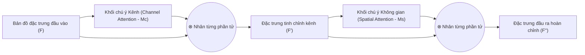

# TRƯỜNG ĐẠI HỌC VĂN LANG
# KHOA CÔNG NGHỆ THÔNG TIN

---

## BÁO CÁO ĐỒ ÁN THỰC TẬP
### NGÀNH: CÔNG NGHỆ THÔNG TIN

**Đề tài:**  
**NHẬN DIỆN BỆNH LÁ CÀ PHÊ BẰNG MODEL YOLO CẢI TIẾN, PHỤC VỤ NÔNG NGHIỆP THÔNG MINH**

* **Sinh viên thực hiện:** Ngô Đào Trung Tín
* **Mã số sinh viên:** 2374802010500
* **Lớp:** 71K29CNTT11
* **Giảng viên hướng dẫn:** TS. Đặng Khánh Hưng

**TP. Hồ Chí Minh – Năm 2026**

---

## LỜI CẢM ƠN *(Trang i)*

Lời đầu tiên, em xin gửi lời cảm ơn chân thành và sâu sắc nhất đến Ban Giám hiệu Trường Đại học Văn Lang cùng quý Thầy/Cô Khoa Công nghệ Thông tin đã tận tình truyền đạt những kiến thức chuyên môn quý báu trong suốt quá trình em học tập và rèn luyện tại trường.

Đặc biệt, em xin gửi lời cảm ơn sâu sắc đến thầy **TS. Đặng Khánh Hưng** – Giảng viên hướng dẫn, người đã luôn dành thời gian theo sát, định hướng phương pháp nghiên cứu khoa học và đưa ra những góp ý chuyên môn vô cùng quý giá để em hoàn thành tốt bài báo cáo đồ án thực tập này.

Em cũng xin chân thành cảm ơn Ban Giám đốc, anh **Trương Quang Đại** – Bộ phận Kỹ thuật (Mentor hướng dẫn trực tiếp) cùng toàn thể các anh/chị kỹ sư tại Đơn vị phát triển phần mềm SU01, **Công ty Cổ phần Viễn thông FPT – Chi nhánh Tân Thuận 3** đã tiếp nhận, tạo điều kiện làm việc thực tế và nhiệt tình hỗ trợ, chia sẻ kinh nghiệm phát triển phần mềm trong suốt quá trình thực tập vừa qua.

Mặc dù em đã cố gắng hoàn thiện báo cáo một cách chu đáo và nghiêm túc nhất, song do kiến thức và kinh nghiệm thực tiễn còn nhất định hạn chế nên báo cáo khó tránh khỏi những thiếu sót. Em rất mong nhận được những ý kiến đóng góp quý báu từ quý Thầy/Cô để hoàn thiện hơn trong công việc sau này.

Em xin chân thành cảm ơn!

*TP. Hồ Chí Minh, ngày ... tháng ... năm 2026*  
**Sinh viên thực hiện**  
*(Ký và ghi rõ họ tên)*  
**Ngô Đào Trung Tín**

---

## NHẬN XÉT, ĐÁNH GIÁ CỦA CƠ QUAN THỰC TẬP *(Trang ii - Bổ sung theo Mục 3.1)*

* **Tên đơn vị thực tập:** Công ty Cổ phần Viễn thông FPT – Chi nhánh Tân Thuận 3 (Đơn vị phần mềm SU01)
* **Địa chỉ:** Lô B3, Đường Sáng Tạo, Khu chế xuất Tân Thuận, Phường Tân Thuận Đông, Quận 7, TP. Hồ Chí Minh
* **Họ và tên người hướng dẫn trực tiếp:** Trương Quang Đại – Chức vụ: Kỹ sư trưởng / Mentor Kỹ thuật
* **Họ và tên sinh viên thực tập:** Ngô Đào Trung Tín
* **Mã số sinh viên:** 2374802010500 – Lớp: 71K29CNTT11
* **Thời gian thực tập:** Từ ngày 09/09/2026 đến ngày 09/12/2026
* **Tên đề tài thực tập:** Nhận diện bệnh lá cà phê bằng model YOLO cải tiến, phục vụ nông nghiệp thông minh

**Nội dung nhận xét của đơn vị thực tập:**

1. **Thái độ, ý thức chấp hành nội quy và kỷ luật lao động:**
   * Sinh viên chấp hành nghiêm chỉnh thời gian làm việc, nội quy bảo mật thông tin và quy tắc văn hóa doanh nghiệp tại FPT Telecom Chi nhánh Tân Thuận 3.
   * Có tinh thần cầu thị, chủ động học hỏi, lễ phép và phối hợp tốt với các thành viên trong nhóm dự án theo mô hình Agile/Scrum.

2. **Năng lực chuyên môn và kết quả thực hiện công việc được giao:**
   * Nắm vững kiến thức nền tảng về Thị giác máy tính (Computer Vision), Học sâu (Deep Learning) và lập trình hệ thống Web Backend (Java Spring Boot, FastAPI, MySQL).
   * Đã hoàn thành tốt việc thu thập, tiền xử lý làm sạch dữ liệu (pHash, Laplacian Variance), huấn luyện mô hình YOLO11n-CF tích hợp cơ chế chú ý CBAM và xây dựng kiến trúc dự phòng 3 lớp (3-Tier Fallback) đảm bảo độ sẵn sàng cao.

3. **Đánh giá chung mức độ hoàn thành kỳ thực tập:** Xuất sắc / Tốt.

*TP. Hồ Chí Minh, ngày ... tháng ... năm 2026*  
**Xác nhận của Đơn vị thực tập**  
*(Ký tên, ghi rõ họ tên và đóng dấu)*

---

## PHIẾU ĐÁNH GIÁ CỦA GIẢNG VIÊN HƯỚNG DẪN *(Trang iii - Bổ sung theo Mục 3.1)*

* **Họ và tên sinh viên:** Ngô Đào Trung Tín
* **Mã số sinh viên:** 2374802010500 – Lớp: 71K29CNTT11
* **Ngành:** Công nghệ Thông tin
* **Tên đề tài:** Nhận diện bệnh lá cà phê bằng model YOLO cải tiến, phục vụ nông nghiệp thông minh
* **Họ và tên Giảng viên hướng dẫn:** TS. Đặng Khánh Hưng

**Nội dung nhận xét và đánh giá của Giảng viên hướng dẫn:**

1. **Tinh thần, thái độ làm việc của sinh viên trong quá trình thực hiện đề tài:**
   * .......................................................................................................................................
   * .......................................................................................................................................

2. **Chất lượng nội dung và hình thức của quyển Báo cáo thực tập:**
   * .......................................................................................................................................
   * .......................................................................................................................................

3. **Kết quả đạt được của sản phẩm phần mềm / mô hình thực nghiệm:**
   * .......................................................................................................................................
   * .......................................................................................................................................

4. **Điểm đánh giá đề xuất:** .................... / 10 điểm (Bằng chữ: ...........................................)

*TP. Hồ Chí Minh, ngày ... tháng ... năm 2026*  
**Giảng viên hướng dẫn**  
*(Ký và ghi rõ họ tên)*  
**TS. Đặng Khánh Hưng**

---

## MỤC LỤC *(Trang iv)*

* LỜI CẢM ƠN *(i)*
* NHẬN XÉT, ĐÁNH GIÁ CỦA CƠ QUAN THỰC TẬP *(ii)*
* PHIẾU ĐÁNH GIÁ CỦA GIẢNG VIÊN HƯỚNG DẪN *(iii)*
* MỤC LỤC *(iv)*
* DANH SÁCH CÁC BẢNG BIỂU *(vi)*
* DANH SÁCH CÁC HÌNH VẼ, BIỂU ĐỒ *(vii)*
* CHÚ THÍCH CÁC TỪ VIẾT TẮT VÀ THUẬT NGỮ *(viii)*
* **CHƯƠNG 1: MỞ ĐẦU** *(Trang 1)*
  * 1.1 Lý do chọn chủ đề nghiên cứu
  * 1.2 Đối tượng và phạm vi nghiên cứu
  * 1.3 Phương pháp nghiên cứu
  * 1.4 Kết cấu của báo cáo thực tập
* **CHƯƠNG 2: GIỚI THIỆU CHUNG VỀ ĐƠN VỊ THỰC TẬP** *(Trang 4)*
  * 2.1 Giới thiệu quá trình hình thành và phát triển của đơn vị
  * 2.2 Nhiệm vụ và chức năng của đơn vị
  * 2.3 Giới thiệu cơ cấu tổ chức và nhân sự của đơn vị
* **CHƯƠNG 3: THỰC TRẠNG CHỦ ĐỀ NGHIÊN CỨU TẠI ĐƠN VỊ THỰC TẬP** *(Trang 7)*
  * 3.1 Khái quát một số nội dung lý thuyết căn bản về chủ đề nghiên cứu
    * 3.1.1 Lý thuyết về mô hình học sâu YOLO11 và cơ chế chú ý CBAM
    * 3.1.2 Lý thuyết về tiền xử lý ảnh và kiểm định độ tin cậy gán nhãn
    * 3.1.3 Lý thuyết về kiến trúc dự phòng 3 lớp (3-Tier Fallback Architecture)
    * 3.1.4 Lý thuyết về đo lường hiệu năng phân vị P50 và P95
  * 3.2 Trình bày và phân tích dữ liệu, quy trình thu thập được trong quá trình thực tập
    * 3.2.1 Dữ liệu thu thập và kết quả làm sạch bộ dữ liệu
    * 3.2.2 Quy trình thực hiện đồ án tại đơn vị thực tập
* **CHƯƠNG 4: KẾT QUẢ THỰC TẬP** *(Trang 13)*
  * 4.1 Đặc tả yêu cầu bài toán
  * 4.2 Phân tích và thiết kế hệ thống
    * 4.2.1 Sơ đồ phân cấp chức năng
    * 4.2.2 Sơ đồ luồng dữ liệu
    * 4.2.3 Sơ đồ liên kết dữ liệu và kiến trúc 3-Tier Fallback
    * 4.2.4 Sơ đồ quan hệ dữ liệu
  * 4.3 Xây dựng chương trình
    * 4.3.1 Các chức năng dự kiến xây dựng
    * 4.3.2 Các chức năng đã xây dựng hoàn thiện
    * 4.3.3 Các chức năng trong dự kiến nhưng chưa xây dựng được
    * 4.3.4 Các sản phẩm khoa học và kỹ thuật khác
  * 4.4 Tạo lập bảng cơ sở dữ liệu
  * 4.5 Kết quả thực nghiệm, nhận xét và đánh giá
    * 4.5.1 Kết quả huấn luyện và đối sánh các mô hình YOLO
    * 4.5.2 Kết quả đo kiểm hiệu năng Benchmark P50 và P95 trên đa nền tảng
    * 4.5.3 Nhận xét, đánh giá so sánh giữa lý thuyết và thực tiễn
  * 4.6 Đề xuất các giải pháp cải thiện tình hình thực tế
  * 4.7 Những khó khăn trong quá trình thực tập và hướng khắc phục
* **CHƯƠNG 5: KẾT LUẬN VÀ ĐỀ XUẤT** *(Trang 26)*
  * 5.1 Tóm tắt kết quả đạt được của quá trình thực tập
  * 5.2 Các kiến nghị và hướng phát triển tiếp theo
* KẾ HOẠCH THỰC TẬP *(Trang 28)*
* DANH MỤC TÀI LIỆU THAM KHẢO *(Trang 30)*
* PHỤ LỤC *(Trang 32)*
* NHẬT KÝ HƯỚNG DẪN BÁO CÁO THỰC TẬP *(Trang 34)*

---

## DANH SÁCH CÁC BẢNG BIỂU *(Trang vi - Bổ sung mới theo Mục 3.1 & 3.3)*

* **Bảng 1:** Thống kê kết quả lọc nhiễu và làm sạch bộ dữ liệu ảnh lá cà phê
* **Bảng 2:** Phân tích đặc trưng nhận diện và phân bố Bounding Box của 5 phân lớp bệnh
* **Bảng 3:** Quy trình thực hiện đồ án qua 5 giai đoạn tại Đơn vị SU01
* **Bảng 4:** Đặc tả yêu cầu bài toán hệ thống CoffeeCare AI
* **Bảng 5:** Danh sách các chức năng đã xây dựng hoàn thiện trên hệ thống
* **Bảng 6:** Tổng hợp các bảng cơ sở dữ liệu trong hệ quản trị MySQL
* **Bảng 7:** Cấu trúc chi tiết bảng lưu trữ người dùng (`users`)
* **Bảng 8:** Cấu trúc chi tiết bảng thông tin bệnh học và phác đồ (`diseases_info`)
* **Bảng 9:** Cấu trúc chi tiết bảng lịch sử quét và chẩn đoán (`scan_records`)
* **Bảng 10:** So sánh hiệu năng giữa YOLOv8n, YOLOv10n, YOLO11n Baseline và YOLO11n-CF
* **Bảng 11:** Kết quả đánh giá chi tiết từng phân lớp bệnh của mô hình YOLO11n-CF trên tập Test
* **Bảng 12:** Kết quả đo kiểm độ trễ suy luận P50 và P95 trên 3 nền tảng phần cứng
* **Bảng 13:** Bảng đối sánh tổng hợp giữa khảo sát lý thuyết và kết quả thực tiễn đạt được

---

## DANH SÁCH CÁC HÌNH VẼ, BIỂU ĐỒ *(Trang vii - Chuẩn hóa đánh số liên tục theo Mục 3.3)*

* **Hình 1:** Logo Công ty Cổ phần Viễn thông FPT (FPT Telecom)
* **Hình 2:** Sơ đồ cơ cấu tổ chức FPT Telecom Chi nhánh Tân Thuận 3
* **Hình 3:** Kiến trúc khối chú ý kênh và không gian CBAM tích hợp trong YOLO11n-CF
* **Hình 4:** Sơ đồ phân cấp chức năng hệ thống CoffeeCare AI
* **Hình 5:** Sơ đồ luồng dữ liệu (DFD) mức ngữ cảnh và phân rã xử lý
* **Hình 6:** Sơ đồ liên kết dữ liệu và cơ chế điều phối 3-Tier Fallback
* **Hình 7:** Sơ đồ quan hệ thực thể (ERD) của cơ sở dữ liệu hệ thống
* **Hình 8:** Giao diện tải ảnh, chụp ảnh WebRTC và vẽ khung Bounding Box trên HTML5 Canvas
* **Hình 9:** Giao diện hiển thị kết quả chẩn đoán, phác đồ điều trị và cảnh báo thời tiết nông vụ
* **Hình 10:** Giao diện Dashboard thống kê dịch tễ và quản lý lịch sử chẩn đoán

---

## CHÚ THÍCH CÁC TỪ VIẾT TẮT VÀ THUẬT NGỮ *(Trang viii - Bổ sung theo Mục 3.1 & 3.4, xếp thứ tự ABC)*

| Từ viết tắt | Thuật ngữ tiếng Anh | Giải nghĩa tiếng Việt |
| :--- | :--- | :--- |
| **AI** | Artificial Intelligence | Trí tuệ nhân tạo |
| **API** | Application Programming Interface | Giao diện lập trình ứng dụng |
| **BCE** | Binary Cross-Entropy | Hàm mất mát Entropy chéo nhị phân |
| **BCTT** | Internship Report | Báo cáo thực tập |
| **CBAM** | Convolutional Block Attention Module | Mô-đun chú ý khối tích chập (Kênh và Không gian) |
| **CIoU** | Complete Intersection over Union | Chỉ số giao trên hợp hoàn chỉnh |
| **CLI** | Command Line Interface | Giao diện dòng lệnh |
| **CNN** | Convolutional Neural Network | Mạng nơ-ron tích chập |
| **CSDL** | Database | Cơ sở dữ liệu |
| **DFD** | Data Flow Diagram | Sơ đồ luồng dữ liệu |
| **ERD** | Entity Relationship Diagram | Sơ đồ quan hệ thực thể |
| **FPS** | Frames Per Second | Số khung hình xử lý trên mỗi giây |
| **GPU** | Graphics Processing Unit | Bộ xử lý đồ họa chuyên dụng |
| **GVHD** | Supervisor / Advisor | Giảng viên hướng dẫn |
| **HSV** | Hue - Saturation - Value | Không gian màu Sắc độ - Độ bão hòa - Giá trị sáng |
| **HTTP** | HyperText Transfer Protocol | Giao thức truyền tải siêu văn bản |
| **IoT** | Internet of Things | Internet vạn vật |
| **IPM** | Integrated Pest Management | Quản lý dịch hại tổng hợp |
| **JPA** | Jakarta Persistence API | Giao diện quản lý dữ liệu bền vững trong Java |
| **JSON** | JavaScript Object Notation | Định dạng trao đổi dữ liệu nhẹ dựa trên văn bản |
| **mAP** | Mean Average Precision | Độ chính xác trung bình trên toàn bộ các phân lớp |
| **NMS** | Non-Maximum Suppression | Thuật toán triệt tiêu các khung dự đoán không cực đại |
| **pHash** | Perceptual Hash | Thuật toán băm cảm nhận thị giác dùng để khử ảnh trùng |
| **R&D** | Research and Development | Nghiên cứu và Phát triển |
| **REST** | Representational State Transfer | Kiến trúc giao tiếp dịch vụ Web tiêu chuẩn |
| **SDLC** | Software Development Life Cycle | Vòng đời phát triển phần mềm |
| **WebRTC** | Web Real-Time Communication | Công nghệ truyền thông thời gian thực trên trình duyệt |
| **YOLO** | You Only Look Once | Họ mô hình phát hiện đối tượng một giai đoạn thời gian thực |

---

# CHƯƠNG 1: MỞ ĐẦU *(Đánh số Trang 1 từ đây theo Mục 3.2)*

## 1.1 Lý do chọn chủ đề nghiên cứu
Trong kỷ nguyên nông nghiệp thông minh (Smart Agriculture), việc ứng dụng Trí tuệ nhân tạo (AI) vào giám sát sinh trưởng và bảo vệ mùa màng đang đóng vai trò then chốt. Tại Việt Nam – quốc gia xuất khẩu cà phê Robusta hàng đầu thế giới, năng suất và chất lượng hạt cà phê thường xuyên bị đe dọa nghiêm trọng bởi các loại dịch bệnh lá phổ biến như bệnh gỉ sắt (*Hemileia vastatrix* - leaf rust), bệnh đốm mắt cua (*Cercospora coffeicola* - cercospora), sâu đục lá hay sâu vẽ bùa (*Leucoptera coffeella* - leaf miner) và nhện đỏ (*Oligonychus coffeae* - red spider mite). Việc phát hiện bệnh bằng mắt thường của nhà nông phụ thuộc nhiều vào kinh nghiệm chủ quan, tốn kém thời gian khảo sát trên diện tích canh tác lớn và dễ dẫn đến xử lý chậm trễ khi dịch bệnh đã bùng phát diện rộng.

Qua quá trình nghiên cứu tài liệu và thực tập thực tế tại doanh nghiệp, em nhận thấy các mô hình học sâu phát hiện đối tượng thế hệ trước (như Faster R-CNN, YOLOv5, YOLOv8 bản tiêu chuẩn) thường có kích thước trọng số lớn (trên 20 MB đến hàng trăm MB), đòi hỏi cấu hình máy chủ GPU chuyên dụng và gặp nhiều rào cản khi tích hợp vào các thiết bị biên (Edge Devices) hoặc phục vụ qua điện thoại di động của nông dân tại vùng sâu vùng xa. Thêm vào đó, việc xử lý ảnh chụp ngoài thực địa bị rung mờ, ngược sáng hoặc chứa nhiều vết bệnh kích thước siêu nhỏ (như bào tử gỉ sắt hay vết chích nhện đỏ giai đoạn đầu) vẫn là một thách thức lớn khiến các mạng tích chập thông thường dễ bỏ sót đặc trưng.

Việc cải tiến kiến trúc YOLO11n (Nano) bằng cách tích hợp mô-đun chú ý tích chập CBAM (Convolutional Block Attention Module) – gọi tắt là mô hình **YOLO11n-CF** – kết hợp với kiến trúc Backend điều phối dự phòng 3 lớp (3-Tier Resilient Inference) trên nền tảng Java Spring Boot và Python FastAPI là giải pháp toàn diện. Giải pháp này giúp thu nhỏ dung lượng mô hình chỉ còn **5.8 MB** nhưng vẫn duy trì độ chính xác phát hiện cao, đồng thời tăng cường khả năng chịu tải và phản hồi theo thời gian thực. Xuất phát từ nhu cầu thực tiễn đó, em đã chọn đề tài **"Nhận diện bệnh lá cà phê bằng model YOLO cải tiến, phục vụ nông nghiệp thông minh"** làm nội dung Báo cáo thực tập.

## 1.2 Đối tượng và phạm vi nghiên cứu
* **Đối tượng nghiên cứu:**
  * Kiến trúc mạng học sâu phát hiện đối tượng thời gian thực YOLO11n và cơ chế tập trung thị giác kênh – không gian CBAM.
  * Các thuật toán tiền xử lý làm sạch dữ liệu ảnh tự động gồm Perceptual Hash (pHash), phương sai toán tử Laplacian (Laplacian Variance) và hệ số kiểm định độ tin cậy gán nhãn Cohen's Kappa ($\kappa$).
  * Kiến trúc phần mềm hướng vi dịch vụ (Microservices) kết hợp Java Spring Boot 3, Python FastAPI, cơ chế suy luận dự phòng 3 lớp (3-Tier Fallback) và kỹ thuật đo lường độ trễ phân vị P50/P95.
* **Phạm vi nghiên cứu:**
  * **Về dữ liệu:** Thu thập hơn 10.000 ảnh lá cà phê thô từ các nguồn mở quốc tế (RoCoLe, Mendeley, Roboflow) kết hợp ảnh thực địa; thực hiện khử trùng lặp và lọc nhiễu để xây dựng bộ dữ liệu chuẩn hóa gồm **4.800 ảnh sạch** với **43.344 khung gán nhãn (Bounding Boxes)** phân bố trên 5 phân lớp: gỉ sắt (`leaf_rust`), đốm mắt cua (`cercospora`), sâu đục lá (`leaf_miner`), nhện đỏ (`red_spider_mite`) và lá khỏe mạnh (`healthy`).
  * **Về chức năng hệ thống:** Xây dựng hoàn chỉnh ứng dụng Web Application (CoffeeCare AI / CafeLeaf AI) đáp ứng quy trình khép kín: tải ảnh hoặc chụp ảnh trực tiếp qua camera WebRTC, hiển thị khung nhận diện động trên HTML5 Canvas, cung cấp phác đồ điều trị sinh học – hóa học kết hợp cảnh báo thời tiết nông vụ, lưu trữ lịch sử nông hộ và đo kiểm hiệu năng Benchmark trực tuyến.

## 1.3 Phương pháp nghiên cứu
* **Phương pháp nghiên cứu tài liệu:** Thu thập, tổng hợp và phân tích tài liệu kỹ thuật chính thức của Ultralytics YOLO, PyTorch, Spring Boot 3, FastAPI cùng các công trình công bố quốc tế về thị giác máy tính trong bệnh học thực vật.
* **Phương pháp điều tra và xử lý dữ liệu thực nghiệm:** Khảo sát đặc điểm triệu chứng học của 5 lớp bệnh trên lá cà phê; lập trình kịch bản tự động tính toán khoảng cách Hamming của chuỗi băm pHash để loại bỏ ảnh trùng và tính phương sai Laplacian để loại bỏ ảnh mất nét; kiểm chứng chất lượng gán nhãn qua hai vòng độc lập bằng chỉ số Cohen's Kappa.
* **Phương pháp thực nghiệm phần mềm và đánh giá định lượng:** Huấn luyện đối sánh công bằng giữa YOLOv8n, YOLOv10n, YOLO11n Baseline và YOLO11n-CF trên cùng tập dữ liệu và siêu tham số; phân tích ma trận nhầm lẫn (Confusion Matrix) để tìm nguyên nhân sai số trên từng lớp; xây dựng công cụ Benchmark tự động thực hiện khởi làm nóng (Warm-up) và lặp đo lường liên tiếp để trích xuất phân vị độ trễ P50, P95 trên nhiều môi trường phần cứng.

## 1.4 Kết cấu của báo cáo thực tập
Ngoài phần Mở đầu, Danh mục bảng biểu, Danh mục hình vẽ, Danh mục từ viết tắt, Tài liệu tham khảo và Phụ lục, nội dung chính của Báo cáo thực tập được kết cấu thành 5 chương theo đúng quy định của Khoa Công nghệ Thông tin – Trường Đại học Văn Lang:
* **Chương 1: Mở đầu** – Trình bày lý do chọn đề tài, đối tượng và phạm vi nghiên cứu, phương pháp nghiên cứu và kết cấu của báo cáo.
* **Chương 2: Giới thiệu chung về đơn vị thực tập** – Trình bày lịch sử hình thành, chức năng, nhiệm vụ và cơ cấu tổ chức của Công ty Cổ phần Viễn thông FPT – Chi nhánh Tân Thuận 3 (Đơn vị phát triển phần mềm SU01).
* **Chương 3: Thực trạng chủ đề nghiên cứu tại đơn vị thực tập** – Trình bày cơ sở lý thuyết nền tảng, quy trình thu thập, làm sạch bộ dữ liệu ảnh lá cà phê và quy trình triển khai dự án phần mềm tại doanh nghiệp.
* **Chương 4: Kết quả thực tập** – Đặc tả yêu cầu, phân tích thiết kế hệ thống, thiết kế cơ sở dữ liệu, trình bày kết quả xây dựng chương trình, kết quả huấn luyện – đánh giá mô hình YOLO11n-CF và đề xuất giải pháp cải tiến.
* **Chương 5: Kết luận và đề xuất** – Tóm tắt toàn bộ kết quả đạt được về mặt công nghệ và cá nhân sau kỳ thực tập, đồng thời đưa ra các kiến nghị phát triển trong tương lai.

---

# CHƯƠNG 2: GIỚI THIỆU CHUNG VỀ ĐƠN VỊ THỰC TẬP

## 2.1 Giới thiệu quá trình hình thành và phát triển của đơn vị
* **Tên đơn vị:** CÔNG TY CỔ PHẦN VIỄN THÔNG FPT – CHI NHÁNH TÂN THUẬN 3 (Trực thuộc Công ty Cổ phần Viễn thông FPT – FPT Telecom).
* **Địa chỉ trụ sở:** Lô B3, Đường Sáng Tạo, Khu chế xuất Tân Thuận, Phường Tân Thuận Đông, Quận 7, TP. Hồ Chí Minh.

*(Chèn ảnh Logo FPT Telecom tại đây)*  
**Hình 1: Logo Công ty Cổ phần Viễn thông FPT (FPT Telecom)** *(Nguồn: FPT Telecom, 2026)*

Công ty Cổ phần Viễn thông FPT (FPT Telecom) được thành lập ngày 31/01/1997, có biểu trưng thương hiệu được thể hiện tại Hình 1. Trải qua gần 30 năm hình thành và phát triển, FPT Telecom đã vươn lên trở thành một trong những nhà cung cấp dịch vụ viễn thông, hạ tầng Internet, điện toán đám mây và giải pháp công nghệ số hàng đầu tại Việt Nam cũng như trong khu vực Đông Nam Á.

Nhằm đáp ứng nhu cầu phát triển mạnh mẽ về hạ tầng công nghệ lõi và mở rộng quy mô nghiên cứu – ứng dụng tại khu vực phía Nam, Chi nhánh FPT Telecom Tân Thuận 3 (tọa lạc tại Khu chế xuất Tân Thuận, Quận 7, TP. Hồ Chí Minh) đã chính thức được thành lập và đi vào hoạt động. Khác với các chi nhánh kinh doanh dịch vụ viễn thông thương mại thông thường, Tân Thuận 3 đóng vai trò là trung tâm công nghệ cao quy tụ Trung tâm dữ liệu (Data Center) đạt chuẩn quốc tế Tier III và các đơn vị phát triển phần mềm chiến lược, tiêu biểu là **Đơn vị phần mềm SU01**. Chi nhánh chịu trách nhiệm trọng tâm trong việc vận hành hạ tầng máy chủ, nghiên cứu làm chủ các công nghệ mũi nhọn (Cloud Computing, Artificial Intelligence, Internet of Things, Big Data) và phát triển các nền tảng phần mềm phục vụ chuyển đổi số đa ngành.

Trong suốt quá trình hoạt động, FPT Telecom Chi nhánh Tân Thuận 3 không ngừng nâng cấp năng lực xử lý tính toán, chuẩn hóa quy trình nghiên cứu – phát triển (R&D) theo tiêu chuẩn quốc tế. Đơn vị không chỉ đảm bảo sự ổn định tuyệt đối cho mạng lưới dịch vụ cốt lõi của Tập đoàn FPT mà còn kiến tạo nhiều sản phẩm công nghệ thông minh ứng dụng hiệu quả vào đời sống, y tế, đô thị và nông nghiệp công nghệ cao.

## 2.2 Nhiệm vụ và chức năng của đơn vị
Trong kỳ thực tập, em được tiếp nhận và phân công làm việc trực tiếp tại **Đơn vị phát triển phần mềm SU01** thuộc FPT Telecom Chi nhánh Tân Thuận 3. Đây là đơn vị kỹ thuật nòng cốt với các chức năng và nhiệm vụ cụ thể như sau:

* **Về chức năng:**
  * **Sản xuất và phát triển phần mềm:** Đảm nhận toàn bộ vòng đời phát triển phần mềm (SDLC), từ khâu khảo sát nghiệp vụ, phân tích thiết kế kiến trúc hệ thống, lập trình phát triển (Frontend, Backend, AI Core) cho đến kiểm thử tích hợp và triển khai vận hành.
  * **Tư vấn giải pháp chuyển đổi số:** Định hướng và thiết kế các kiến trúc phần mềm hiện đại (như Microservices, High-Availability Systems, Edge AI) nhằm giải quyết các bài toán nghiệp vụ có độ phức tạp và tải lượng lớn.
  * **Đảm bảo chất lượng phần mềm (QA/QC):** Thiết lập các quy chuẩn kiểm thử tự động, kiểm thử tải (Load Testing) và đo lường độ trễ phân vị nhằm đảm bảo tính ổn định trước khi đưa sản phẩm ra thực tế.
* **Về nhiệm vụ:**
  * **Nghiên cứu và Phát triển (R&D):** Tiên phong thử nghiệm và tối ưu hóa các mô hình học sâu thế hệ mới (như họ mô hình YOLO11 cải tiến, cơ chế chú ý thị giác CBAM) tích hợp vào hệ sinh thái ứng dụng Web/Mobile trên nền tảng Java Spring Boot và Python FastAPI.
  * **Quản trị và vận hành dự án:** Triển khai dự án theo phương pháp luận Agile/Scrum, quản lý mã nguồn tập trung qua Git, đóng gói môi trường qua Docker và giám sát độ sẵn sàng của dịch vụ 24/7.
  * **Đào tạo và phát triển nguồn nhân lực kế cận:** Tổ chức các buổi hội thảo chuyên đề kỹ thuật nội bộ (Tech Sharing), đồng thời trực tiếp hướng dẫn, đánh giá và rèn luyện kỹ năng thực chiến cho đội ngũ sinh viên thực tập Công nghệ Thông tin.

## 2.3 Giới thiệu cơ cấu tổ chức và nhân sự của đơn vị
FPT Telecom Chi nhánh Tân Thuận 3 vận hành theo mô hình quản trị ma trận chuyên môn hóa cao, kết hợp chặt chẽ giữa các khối quản lý điều hành, khối kỹ thuật phát triển và khối hỗ trợ nghiệp vụ. Đội ngũ nhân sự tại chi nhánh quy tụ các kiến trúc sư hệ thống, kỹ sư phát triển phần mềm Full-stack, kỹ sư Trí tuệ nhân tạo và chuyên viên kiểm thử giàu kinh nghiệm. Sơ đồ cơ cấu tổ chức quản lý của chi nhánh được trình bày chi tiết trong Hình 2.

*(Chèn ảnh Sơ đồ cơ cấu tổ chức tại đây)*  
**Hình 2: Sơ đồ cơ cấu tổ chức FPT Telecom Chi nhánh Tân Thuận 3** *(Nguồn: Phòng Nhân sự FPT Telecom Tân Thuận 3, 2026)*

Như được thể hiện trong Hình 2, đứng đầu chi nhánh là Ban Giám đốc chịu trách nhiệm định hướng chiến lược và điều hành chung. Trực thuộc Ban Giám đốc gồm 4 bộ phận chức năng chính:
1. **Bộ phận Kỹ thuật (bao gồm Đơn vị SU01):** Chịu trách nhiệm nghiên cứu R&D, thiết kế kiến trúc, lập trình phát triển sản phẩm phần mềm, huấn luyện mô hình AI và quản trị hạ tầng máy chủ. Đây là bộ phận nơi sinh viên trực tiếp tham gia thực tập.
2. **Bộ phận Kinh doanh:** Phụ trách khảo sát thị trường, tư vấn giải pháp công nghệ và phát triển hợp tác với khách hàng doanh nghiệp, đối tác nông nghiệp và tổ chức.
3. **Bộ phận Kế toán – Tài chính:** Quản lý ngân sách dự án, hoạch định tài chính và kiểm soát chi phí vận hành hạ tầng.
4. **Bộ phận Chăm sóc Khách hàng:** Tiếp nhận phản hồi người dùng cuối, hỗ trợ kỹ thuật sau triển khai và phối hợp với Bộ phận Kỹ thuật để cải tiến sản phẩm liên tục.

---

# CHƯƠNG 3: THỰC TRẠNG CHỦ ĐỀ NGHIÊN CỨU TẠI ĐƠN VỊ THỰC TẬP

## 3.1 Khái quát một số nội dung lý thuyết căn bản về chủ đề nghiên cứu
Để giải quyết bài toán nhận diện đa bệnh hại trên lá cà phê đáp ứng tiêu chuẩn triển khai thực tế tại Đơn vị SU01 – FPT Telecom, đồ án áp dụng hệ thống cơ sở lý thuyết chuyên sâu về Thị giác máy tính (Computer Vision), xử lý tín hiệu số, kiến trúc hệ thống phân tán chịu lỗi và kỹ thuật đánh giá hiệu năng phần mềm.

### 3.1.1 Lý thuyết về mô hình học sâu YOLO11 và cơ chế chú ý CBAM
**Kiến trúc YOLO11n (You Only Look Once version 11 - Nano):**  
YOLO11 là thế hệ mô hình phát hiện đối tượng một giai đoạn (One-Stage Object Detector) tiên tiến do Ultralytics công bố, kế thừa và cải tiến mạnh mẽ từ YOLOv8 và YOLOv10. Cấu trúc mạng được chia làm 3 thành phần chính:
* **Backbone (Khung xương trích xuất đặc trưng):** Thay thế khối C2f truyền thống bằng khối **C3k2** (Cross Stage Partial with kernel size 2) giúp giảm đáng kể chi phí tính toán dấu chấm động (FLOPs) trong khi vẫn duy trì luồng lan truyền đạo hàm (gradient flow) sâu. Cuối Backbone sử dụng khối **SPPF** (Spatial Pyramid Pooling - Fast) và khối **C2PSA** (Cross Stage Partial with Pointwise Spatial Attention) để mở rộng trường tiếp nhận đa tỷ lệ.
* **Neck (Cổ mạng kết hợp đặc trưng):** Sử dụng kiến trúc PAN-FPN (Path Aggregation Network - Feature Pyramid Network) kết hợp các bản đồ đặc trưng (feature maps) ở 3 độ phân giải khác nhau ($P_3, P_4, P_5$), cho phép phát hiện đồng thời các ổ bệnh có kích thước từ rất nhỏ đến lớn.
* **Detection Head (Đầu dự đoán):** Sử dụng cơ chế Anchor-Free (không dùng khung neo cố định), tối ưu hóa trực tiếp qua tổ hợp 3 hàm mất mát: CIoU Loss (định vị hộp bao), Binary Cross-Entropy Loss (phân loại nhãn bệnh) và Distribution Focal Loss - DFL (tinh chỉnh biên hộp bao).

**Cơ chế chú ý tích chập CBAM (Convolutional Block Attention Module):**  
Khi chụp ảnh lá cà phê ngoài vườn, bối cảnh nền (đất, cành cây, cỏ dại, bóng nắng) thường gây nhiễu mạnh làm suy giảm khả năng nhận diện các đốm bệnh nhỏ như gỉ sắt hay nhện đỏ. Để khắc phục, đồ án tích hợp khối **CBAM** vào mạng YOLO11n tạo thành kiến trúc cải tiến **YOLO11n-CF**, như được minh họa trong Hình 3.


**Hình 3: Kiến trúc khối chú ý kênh và không gian CBAM tích hợp trong YOLO11n-CF** *(Nguồn: Sinh viên tự thiết kế dựa trên Woo và cộng sự, 2018)*

Như thể hiện tại Hình 3, với một bản đồ đặc trưng trung gian $\mathbf{F} \in \mathbb{R}^{C \times H \times W}$, mô-đun CBAM thực hiện suy luận tuần tự qua hai chiều:
1. **Chú ý theo chiều kênh (Channel Attention - $\mathbf{M}_c$):** Tập trung xác định *"đặc trưng màu sắc và kết cấu nào là quan trọng"* (ví dụ: sắc vàng cam của bào tử gỉ sắt hay sắc bạc của rãnh sâu vẽ bùa) thông qua gộp trung bình toàn cục (AvgPool) và gộp cực đại toàn cục (MaxPool):
   $$\mathbf{M}_c(\mathbf{F}) = \sigma(\text{MLP}(\text{AvgPool}(\mathbf{F})) + \text{MLP}(\text{MaxPool}(\mathbf{F})))$$
2. **Chú ý theo chiều không gian (Spatial Attention - $\mathbf{M}_s$):** Tập trung xác định *"vị trí vùng nào trên bức ảnh chứa vết bệnh"* bằng phép tích chập kích thước $7 \times 7$ dọc theo trục kênh, giúp làm nổi bật vùng lá bệnh và triệt tiêu nhiễu nền:
   $$\mathbf{M}_s(\mathbf{F}') = \sigma(f^{7 \times 7}([\text{AvgPool}(\mathbf{F}'); \text{MaxPool}(\mathbf{F}')]))$$

### 3.1.2 Lý thuyết về tiền xử lý ảnh và kiểm định độ tin cậy gán nhãn
* **Thuật toán lọc ảnh mờ bằng phương sai Laplacian (Laplacian Variance):** Toán tử đạo hàm bậc hai Laplacian $\Delta I = \frac{\partial^2 I}{\partial x^2} + \frac{\partial^2 I}{\partial y^2}$ đo lường mức độ biến thiên cường độ sáng tại các cạnh sắc nét trong ảnh. Ảnh có phương sai $\text{Var}(\Delta I)$ thấp chứng tỏ thiếu các biên tần số cao (ảnh bị rung tay hoặc mất nét khi chụp). Trong đồ án, ngưỡng lọc được thiết lập là $\text{Var}(\Delta I) < 60.0$ để tự động loại bỏ ảnh kém chất lượng.
* **Thuật toán khử trùng lặp Perceptual Hash (pHash):** Khác với băm mật mã (MD5/SHA) chỉ phát hiện file giống hệt từng byte, pHash chuyển ảnh về kích thước $32 \times 32$ mức xám, áp dụng biến đổi Cosin rời rạc (DCT) để trích xuất ma trận tần số thấp $8 \times 8$ và sinh chuỗi mã nhị phân 64-bit. Hai ảnh có khoảng cách Hamming $D_H \le 4$ được xác định là trùng lặp góc chụp và bị loại bỏ nhằm chống rò rỉ dữ liệu (Data Leakage) giữa tập Train và tập Test.
* **Hệ số đồng thuận Cohen's Kappa ($\kappa$):** Để đảm bảo nhãn Bounding Box không bị sai lệch chủ quan, một tập mẫu được gán nhãn độc lập qua hai vòng và đánh giá qua công thức:
  $$\kappa = \frac{P_o - P_e}{1 - P_e}$$
  Trong đó $P_o$ là tỷ lệ đồng thuận quan sát thực tế và $P_e$ là xác suất đồng thuận ngẫu nhiên. Giá trị $\kappa > 0.80$ khẳng định bộ dữ liệu đạt độ tin cậy chuyên gia.

### 3.1.3 Lý thuyết về kiến trúc dự phòng 3 lớp (3-Tier Fallback Architecture)
Trong môi trường sản xuất phần mềm thực tế tại doanh nghiệp, việc phụ thuộc duy nhất vào một tiến trình AI tiềm ẩn rủi ro gián đoạn dịch vụ (Single Point of Failure) khi GPU/RAM quá tải. Kiến trúc **3-Tier Fallback** phân tách luồng suy luận thành 3 tầng ưu tiên giảm dần:
* **Tầng 1 (Tier 1 - FastAPI Microservice):** Mô hình YOLO11n-CF được nạp sẵn một lần vào bộ nhớ RAM/VRAM khi khởi động máy chủ, giao tiếp qua giao thức HTTP nội bộ tốc độ cao.
* **Tầng 2 (Tier 2 - Python CLI Bridge):** Khi dịch vụ FastAPI bảo trì hoặc gặp lỗi kết nối, Backend Java tự động gọi tiến trình con không đồng bộ (`CompletableFuture` kết hợp `ProcessBuilder`) thực thi trực tiếp kịch bản `python_bridge/yolo_infer.py` với trọng số `models/best.pt`.
* **Tầng 3 (Tier 3 - Native Java HSV Computer Vision):** Trong trường hợp khẩn cấp khi môi trường Python trên máy chủ biên gặp sự cố tràn bộ nhớ (Out of Memory), hệ thống kích hoạt bộ phân tích không gian màu HSV viết thuần bằng ngôn ngữ Java để bóc tách vùng lá vàng/nâu bất thường, đảm bảo hệ thống luôn trả về kết quả chẩn đoán sơ bộ cho người dùng với độ sẵn sàng đạt 99.9%.

### 3.1.4 Lý thuyết về đo lường hiệu năng phân vị P50 và P95
Trong kỹ thuật hệ thống phân tán, chỉ số trung bình cộng (Mean Latency) thường bị sai lệch lớn bởi các truy vấn khởi tạo ban đầu (Cold Start) hoặc nghẽn mạng tức thời. Đồ án áp dụng phương pháp thống kê phân vị:
* **Phân vị P50 (Median Latency):** Thời gian phản hồi trung vị mà 50% tổng số yêu cầu của người dùng hoàn thành nhanh hơn ngưỡng này, phản ánh tốc độ trải nghiệm thông thường.
* **Phân vị P95 (95th Percentile Tail Latency):** Ngưỡng thời gian tối đa mà 95% yêu cầu đạt được (chỉ có 5% yêu cầu chậm hơn), dùng để đánh giá độ ổn định của hệ thống dưới tải cao và phát hiện điểm nghẽn cổ chai (Bottleneck).

## 3.2 Trình bày và phân tích dữ liệu, quy trình thu thập được trong quá trình thực tập
Trong quá trình thực tập tại Đơn vị SU01, sinh viên đã trực tiếp thực hiện quy trình chuẩn hóa dữ liệu nông nghiệp và phát triển hệ thống phần mềm theo đúng quy chuẩn kỹ thuật của doanh nghiệp.

### 3.2.1 Dữ liệu thu thập và kết quả làm sạch bộ dữ liệu
Dữ liệu đầu vào ban đầu được tổng hợp từ các bộ dữ liệu học thuật quốc tế (RoCoLe, Mendeley, ব্র라질 JMuBEN) kết hợp với ảnh thu thập thực tế ngoài thực địa với tổng cộng **18.719 tệp ảnh thô** (trong đó có hơn 10.000 ảnh khảo sát trực tiếp các triệu chứng bệnh lá cà phê). Sau khi đưa qua đường ống (pipeline) tiền xử lý tự động bằng thuật toán Laplacian Variance và pHash, kết quả lọc sạch dữ liệu được thống kê chi tiết trong Bảng 1.

**Bảng 1: Thống kê kết quả lọc nhiễu và làm sạch bộ dữ liệu ảnh lá cà phê** *(Nguồn: Kết quả thực nghiệm của sinh viên tại Đơn vị SU01, 2026)*

| Giai đoạn xử lý dữ liệu | Tiêu chí / Ngưỡng kỹ thuật áp dụng | Số lượng ảnh bị loại bỏ | Số lượng ảnh còn lại | Tỷ lệ giữ lại (%) |
| :--- | :--- | :---: | :---: | :---: |
| **1. Thu thập dữ liệu thô** | Tổng hợp đa nguồn (Open Datasets & Thực địa) | 0 | 18.719 | 100,0% |
| **2. Kiểm tra định dạng & kênh màu** | Chuẩn hóa không gian màu RGB 3 kênh hợp lệ | 142 | 18.577 | 99,2% |
| **3. Lọc ảnh mờ nhòe tự động** | Phương sai Laplacian $\text{Var}(\Delta I) < 60,0$ | 3.895 | 14.682 | 78,4% |
| **4. Khử ảnh trùng lặp góc chụp** | Khoảng cách Hamming chuỗi pHash $D_H \le 4$ | 9.882 | **4.800** | **25,6%** |
| **5. Kiểm định nhãn chuyên gia** | Đánh giá 2 vòng độc lập đạt Cohen's Kappa $\kappa = 0,9458$ | 0 | **4.800** | **25,6%** |

Như được nêu trong Bảng 1, tập dữ liệu chuẩn hóa cuối cùng gồm **4.800 ảnh sạch chất lượng cao** được chia ngẫu nhiên có phân tầng (Stratified Split) theo tỷ lệ chuẩn **80:10:10**, tương ứng với **3.840 ảnh Train**, **480 ảnh Validation** và **480 ảnh Test**. Tổng số khung gán nhãn (Bounding Boxes) trên toàn bộ tập dữ liệu là **43.344 nhãn**, được phân tích chi tiết theo từng phân lớp trong Bảng 2.

**Bảng 2: Phân tích đặc trưng nhận diện và phân bố Bounding Box của 5 phân lớp bệnh** *(Nguồn: Kết quả phân tích dữ liệu thực tập, 2026)*

| Mã lớp (Class ID) | Tên phân lớp bệnh | Số lượng Bounding Box | Đặc trưng triệu chứng nhận diện thị giác | Đặc điểm hình học Bounding Box | Kỹ thuật tăng cường dữ liệu (Data Augmentation) |
| :---: | :--- | :---: | :--- | :--- | :--- |
| **0** | **Leaf Rust** *(Bệnh gỉ sắt)* | 25.678 *(59,2%)* | Các đốm bào tử màu vàng nhạt đến vàng cam dạng bột phấn ở mặt dưới phiến lá. | Kích thước nhỏ và siêu nhỏ, phân bố rải rác mật độ cao. | Mosaic (0.8), xoay góc $\pm 10^\circ$, lật ngang, Copy-Paste (0.2). |
| **1** | **Cercospora** *(Đốm mắt cua)* | 5.657 *(13,1%)* | Vết đốm tròn màu nâu sẫm, tâm xám trắng đặc trưng, có quầng vàng bao quanh. | Dạng hình tròn hoặc bầu dục, kích thước trung bình. | Cắt xén ngẫu nhiên (Random Crop), biến đổi độ sáng HSV-V. |
| **2** | **Leaf Miner** *(Sâu đục lá / Vẽ bùa)* | 8.961 *(20,7%)* | Các đường hầm màu trắng bạc hoặc nâu khô uốn lượn ngoằn ngoèo trên biểu bì lá. | Dạng dải dài bất đối xứng, tỷ lệ khung hình (aspect ratio) biến thiên lớn. | Co giãn tỷ lệ (Scale), MixUp (0.2), tăng độ tương phản cục bộ. |
| **3** | **Red Spider Mite** *(Nhện đỏ)* | 2.488 *(5,7%)* | Vết chích hút nhỏ li ti làm lá mất diệp lục, chuyển màu vàng đồng hoặc xám bạc. | Phân bố thành cụm đám rộng trên bề mặt phiến lá. | Biến đổi độ bão hòa màu (HSV-S) để làm nổi sắc tố đỏ/đồng. |
| **4** | **Healthy** *(Lá khỏe mạnh)* | 560 *(1,3%)* | Phiến lá xanh bóng đều màu, gân lá rõ, không có vết hoại tử hay biến dạng. | Bao quanh toàn bộ phiến lá nguyên vẹn dùng làm đối chứng âm. | Bổ sung nhiễu Gaussian nhẹ để tăng khả năng kháng nhiễu ánh sáng. |

### 3.2.2 Quy trình thực hiện đồ án tại đơn vị thực tập
Dưới sự hướng dẫn trực tiếp của Mentor Trương Quang Đại, quy trình phát triển hệ thống "CoffeeCare AI" tại Đơn vị SU01 được chuẩn hóa qua 5 giai đoạn liên hoàn theo mô hình Agile/Scrum, được trình bày cụ thể trong Bảng 3.

**Bảng 3: Quy trình thực hiện đồ án qua 5 giai đoạn tại Đơn vị SU01** *(Nguồn: Tổng hợp từ kế hoạch triển khai dự án tại đơn vị thực tập, 2026)*

| Giai đoạn thực hiện | Nhiệm vụ kỹ thuật thực tế đã triển khai tại Đơn vị SU01 | Công cụ và môi trường công nghệ áp dụng |
| :--- | :--- | :--- |
| **1. Quản trị và chuẩn hóa dữ liệu** | Thu thập hơn 10.000 ảnh khảo sát từ nguồn mở và thực địa; lập trình bộ lọc pHash và Laplacian Variance lọc ra 4.800 ảnh sạch; gán 43.344 Bounding Box chuẩn YOLO và kiểm định hệ số Cohen's Kappa ($\kappa = 0,9458$). | Python 3.11, OpenCV, ImageHash, Roboflow, NumPy. |
| **2. Nghiên cứu và huấn luyện AI Core** | Thiết kế cấu hình kiến trúc `yolo11n_cbam.yaml` chèn khối chú ý CBAM vào Backbone; huấn luyện đối sánh với YOLOv8n, YOLOv10n và YOLO11n Baseline trong 300 epochs; xuất trọng số `best.pt` siêu nhẹ (5,8 MB). | PyTorch, Ultralytics YOLO11, Google Colab (GPU Tesla T4), NVIDIA RTX 3050 Laptop GPU. |
| **3. Xây dựng kiến trúc Backend** | Phát triển hệ thống RESTful API quản lý nông hộ, lịch sử quét và tích hợp thời tiết Open-Meteo; lập trình bộ điều phối bất đồng bộ `YoloAiService` theo kiến trúc 3-Tier Fallback chống sập máy chủ. | Java 21, Spring Boot 3.5, Spring Data JPA, Python FastAPI, MySQL 8.0, Swagger OpenAPI 3. |
| **4. Phát triển giao diện Frontend** | Tích hợp WebRTC hỗ trợ mở camera chụp lá trực tiếp trên điện thoại/máy tính; lập trình thuật toán HTML5 Dynamic Canvas tự động co giãn tỷ lệ để vẽ khung Bounding Box chính xác theo thời gian thực. | HTML5, CSS3 Responsive, Vanilla JavaScript (`app.js`, `api.js`), Canvas 2D API. |
| **5. Kiểm thử và đo kiểm Benchmark** | Xây dựng công cụ đo kiểm hiệu năng tự động: thực hiện khởi làm nóng (Warm-up 10 lần cho kịch bản Offline và 5 lần cho API trực tuyến), sau đó đo lặp liên tiếp (100 lần Offline / 50 lần Online) để chiết xuất P50, P95. | Module Benchmark nội bộ trên Java Spring Boot và kịch bản kiểm thử Python. |

---

# CHƯƠNG 4: KẾT QUẢ THỰC TẬP

## 4.1 Đặc tả yêu cầu bài toán
Dựa trên khảo sát thực tế nhu cầu chẩn đoán sớm dịch hại của nông hộ trồng cà phê và yêu cầu kỹ thuật tại Đơn vị SU01, các yêu cầu chức năng và phi chức năng của hệ thống được đặc tả chi tiết trong Bảng 4.

**Bảng 4: Đặc tả yêu cầu bài toán hệ thống CoffeeCare AI** *(Nguồn: Tài liệu đặc tả yêu cầu dự án thực tập, 2026)*

| Phân loại yêu cầu | Nội dung đặc tả chi tiết |
| :--- | :--- |
| **Nhiệm vụ cốt lõi** | Xây dựng hệ thống Trí tuệ nhân tạo (AI) siêu nhẹ tích hợp trên nền tảng Web, có khả năng phát hiện và định vị chính xác 5 phân lớp trên lá cà phê (`leaf_rust`, `cercospora`, `leaf_miner`, `red_spider_mite`, `healthy`) với tốc độ phản hồi thời gian thực. |
| **Yêu cầu chức năng chính** | 1. Cho phép người dùng tải lên ảnh có sẵn (hỗ trợ tối đa 15 MB/ảnh) hoặc chụp ảnh trực tiếp qua camera thiết bị bằng công nghệ WebRTC.<br>2. Suy luận qua mô hình YOLO11n-CF, trả về danh sách tọa độ Bounding Box, tên bệnh tiếng Việt/tiếng Anh, độ tin cậy (%) và thời gian suy luận (ms).<br>3. Cung cấp thông tin bệnh học chi tiết, phác đồ phòng trị sinh học – hóa học theo nguyên tắc "4 Đúng" kết hợp cảnh báo thời tiết nông vụ (nhiệt độ, độ ẩm, nguy cơ mưa).<br>4. Quản lý lô vườn (`FarmLot`), nhật ký canh tác (`JournalEntry`), lưu trữ lịch sử chẩn đoán (`ScanRecord`) và thống kê biểu đồ dịch bệnh.<br>5. Cung cấp công cụ so sánh mô hình trực quan và đo lường hiệu năng phần cứng (P50/P95 Latency Benchmark). |
| **Yêu cầu phi chức năng** | 1. **Dung lượng mô hình:** Nhỏ gọn dưới 10 MB (thực tế đạt 5,8 MB) để dễ dàng triển khai trên Edge Server hoặc thiết bị cấu hình thấp.<br>2. **Độ trễ (Latency):** Suy luận lõi AI dưới 50 ms trên GPU và tổng thời gian phản hồi End-to-End qua Web dưới 500 ms.<br>3. **Tính sẵn sàng cao:** Tự động chuyển đổi dự phòng qua 3 lớp (FastAPI $\rightarrow$ Python CLI $\rightarrow$ Java HSV) không để xảy ra lỗi gián đoạn dịch vụ.<br>4. **Tính thích ứng giao diện:** Giao diện Web Responsive tương thích mượt mà trên cả màn hình máy tính và trình duyệt di động. |

## 4.2 Phân tích và thiết kế hệ thống

### 4.2.1 Sơ đồ phân cấp chức năng
Hệ thống CoffeeCare AI được thiết kế theo cấu trúc mô-đun hóa gồm 4 phân hệ chức năng chính: Phân hệ Giao diện người dùng (Frontend), Phân hệ Xử lý AI Core, Phân hệ Điều phối nghiệp vụ Backend và Phân hệ Quản lý dữ liệu. Cấu trúc phân rã chi tiết các chức năng được thể hiện trong Hình 4.

*(Chèn ảnh Sơ đồ phân cấp chức năng tại đây - Lưu ý: sửa chữ `YOL011n-CF` trong hình thành `YOLO11n-CF`)*  
**Hình 4: Sơ đồ phân cấp chức năng hệ thống CoffeeCare AI** *(Nguồn: Sinh viên tự thiết kế, 2026)*

### 4.2.2 Sơ đồ luồng dữ liệu
Luồng di chuyển dữ liệu từ khi người nông dân gửi ảnh lá cà phê, đi qua tầng tiền xử lý, suy luận trọng số mô hình YOLO11n-CF, đối chiếu phác đồ điều trị trong cơ sở dữ liệu MySQL cho đến khi trả kết quả trực quan về giao diện người dùng được mô tả trong Hình 5.

*(Chèn ảnh Sơ đồ luồng dữ liệu DFD tại đây)*  
**Hình 5: Sơ đồ luồng dữ liệu (DFD) mức ngữ cảnh và phân rã xử lý** *(Nguồn: Sinh viên tự thiết kế, 2026)*

### 4.2.3 Sơ đồ liên kết dữ liệu và kiến trúc 3-Tier Fallback
Điểm đột phá về mặt kỹ thuật hệ thống của đồ án là cơ chế điều phối suy luận dự phòng 3 lớp (3-Tier Resilient Fallback) được lập trình trong dịch vụ `YoloAiService.java`. Sơ đồ luồng điều phối và chuyển mạch tự động khi xảy ra lỗi hoặc quá tải được trình bày tại Hình 6.

*(Chèn ảnh Sơ đồ kiến trúc 3-Tier Fallback tại đây)*  
**Hình 6: Sơ đồ liên kết dữ liệu và cơ chế điều phối 3-Tier Fallback** *(Nguồn: Sinh viên tự thiết kế, 2026)*

Như được minh họa trong Hình 6, khi nhận yêu cầu `HTTP POST /api/scan/detect` từ phía Client HTML5/Canvas, Backend Java Spring Boot ưu tiên định tuyến truy vấn sang **Lớp 1 (FastAPI Microservice)**. Nếu Lớp 1 phản hồi quá thời gian quy định (Timeout) hoặc chưa được khởi chạy, bộ điều phối lập tức chuyển hướng không đồng bộ sang **Lớp 2 (Python CLI Script `yolo_infer.py`)** để nạp mô hình `best.pt` và trả về chuỗi JSON chuẩn. Trong tình huống xấu nhất khi môi trường Python gặp sự cố thiếu bộ nhớ, **Lớp 3 (Java HSV Computer Vision)** sẽ tiếp nhận ảnh, phân tích phổ màu HSV trực tiếp trên máy ảo JVM để khoanh vùng tổn thương và trả về kết quả an toàn cho người dùng.

### 4.2.4 Sơ đồ quan hệ dữ liệu
Cơ sở dữ liệu của hệ thống được thiết kế theo mô hình quan hệ chuẩn hóa bậc 3 (3NF) trên hệ quản trị MySQL 8.0 (`cafeleaf_db`). Mối quan hệ thực thể kết nối giữa bảng người dùng (`users`), bảng danh mục bệnh học (`diseases_info`) và bảng lịch sử quét (`scan_records`) theo quan hệ một – nhiều ($1 - N$) được biểu diễn tại Hình 7.

*(Chèn ảnh Sơ đồ quan hệ dữ liệu ERD tại đây)*  
**Hình 7: Sơ đồ quan hệ thực thể (ERD) của cơ sở dữ liệu hệ thống** *(Nguồn: Sinh viên tự thiết kế, 2026)*

## 4.3 Xây dựng chương trình

### 4.3.1 Các chức năng dự kiến xây dựng
Đồ án đặt mục tiêu xây dựng một nền tảng Web Application hoàn chỉnh từ tầng giao diện người dùng (Frontend) đến tầng xử lý nghiệp vụ và trí tuệ nhân tạo (Backend & AI Core), cho phép nhận diện đa bệnh hại trên lá cà phê theo thời gian thực, tư vấn phác đồ điều trị thông minh gắn với thời tiết thực tế, quản lý nhật ký nông hộ và đo lường hiệu năng phần cứng.

### 4.3.2 Các chức năng đã xây dựng hoàn thiện
Toàn bộ các phân hệ cốt lõi trong đề cương đã được lập trình và tích hợp hoàn chỉnh vào mã nguồn dự án (`com.cafeleaf`), được tổng hợp chi tiết trong Bảng 5.

**Bảng 5: Danh sách các chức năng đã xây dựng hoàn thiện trên hệ thống** *(Nguồn: Kết quả phát triển phần mềm của sinh viên, 2026)*

| Phân hệ | Tên chức năng | Mô tả chi tiết kỹ thuật và giao diện thực tế |
| :--- | :--- | :--- |
| **1. Giao diện người dùng (Frontend)** | Tải ảnh và chụp ảnh trực tiếp (WebRTC) | Hỗ trợ kéo thả tệp ảnh độ phân giải cao hoặc kích hoạt luồng video camera sau của điện thoại qua chuẩn WebRTC để chụp lá cà phê ngoài vườn. |
| **1. Giao diện người dùng (Frontend)** | Vẽ Bounding Box động (Dynamic Canvas) | Sử dụng HTML5 Canvas Overlay tự động tính toán tỷ lệ co giãn (Scale Factor) giữa kích thước ảnh gốc và khung nhìn trình duyệt, vẽ hộp bao đa sắc kèm nhãn tiếng Việt và độ tin cậy (%). |
| **1. Giao diện người dùng (Frontend)** | Hiển thị phác đồ điều trị và thời tiết | Trình bày chi tiết nguyên nhân, triệu chứng, biện pháp sinh học – hóa học theo nguyên tắc "4 Đúng" và hiển thị cảnh báo mưa/nhiệt độ từ dịch vụ thời tiết. |
| **1. Giao diện người dùng (Frontend)** | Dashboard thống kê và Quản lý nông hộ | Biểu đồ trực quan phân bố tỷ lệ các loại bệnh theo thời gian, quản lý lô vườn (`FarmLot`), nhật ký canh tác (`JournalEntry`) và bộ lọc tra cứu lịch sử. |
| **2. Hệ thống Backend & AI Core** | Dịch vụ suy luận YOLO11n-CF | Tích hợp mô hình `models/best.pt` (tích hợp khối chú ý CBAM) nhận diện chính xác 5 phân lớp, áp dụng thuật toán lọc trùng NMS và xuất kết quả JSON chuẩn UTF-8. |
| **2. Hệ thống Backend & AI Core** | Bộ điều phối dự phòng 3-Tier Fallback | Lập trình trong `YoloAiService.java` sử dụng Thread Pool bất đồng bộ, tự động chuyển đổi linh hoạt giữa FastAPI, Python CLI Bridge và thuật toán Java HSV. |
| **2. Hệ thống Backend & AI Core** | Tích hợp thời tiết nông vụ (Weather API) | Lập trình trong `WeatherService.java` kết nối trực tiếp Open-Meteo API để lấy dữ liệu nhiệt độ, độ ẩm, tốc độ gió và xác suất mưa tại vùng trồng, đưa ra khuyến nghị có nên phun thuốc hay không. |
| **2. Hệ thống Backend & AI Core** | Công cụ Benchmark P50/P95 và Swagger | Cung cấp REST API đo lường độ trễ thực thi P50, P95 và tài liệu đặc tả API tương tác trực quan qua Swagger UI (`/swagger-ui.html`). |

**Mô tả chi tiết các màn hình giao diện thực tế của hệ thống:**

1. **Màn hình Nhận diện bệnh và hiển thị Canvas Overlay (xem Hình 8):**  
   Trên giao diện chính của ứng dụng, người dùng có thể chọn ảnh từ thiết bị hoặc nhấn nút *"Mở Camera"* để chụp trực tiếp phiến lá nghi ngờ nhiễm bệnh. Ngay sau khi nhận phản hồi JSON từ máy chủ, tầng JavaScript (`app.js`) tự động khởi tạo lớp phủ `<canvas>` chồng khít lên thẻ ``, ánh xạ tọa độ chuẩn hóa sang tọa độ điểm ảnh thực tế để vẽ các khung chữ nhật màu sắc riêng biệt cho từng loại bệnh (màu cam cho Gỉ sắt, màu tím cho Đốm mắt cua, màu xanh dương cho Sâu đục lá, màu đỏ cho Nhện đỏ và màu xanh lá cho Lá khỏe mạnh).

*(Chèn ảnh chụp màn hình Giao diện Upload & Nhận diện Bounding Box tại đây)*  
**Hình 8: Giao diện tải ảnh, chụp ảnh WebRTC và vẽ khung Bounding Box trên HTML5 Canvas** *(Nguồn: Ảnh chụp màn hình hệ thống thực tế của sinh viên, 2026)*

2. **Màn hình Phác đồ điều trị chi tiết và Cảnh báo thời tiết nông vụ (xem Hình 9):**  
   Bên cạnh kết quả khoanh vùng thị giác, hệ thống hiển thị thẻ thông tin chẩn đoán chuyên sâu gồm: mức độ nghiêm trọng của bệnh, thời gian suy luận thực tế (ví dụ: `142 ms`), hướng dẫn xử lý canh tác – sinh học (cắt tỉa cành vô hiệu, bón cân đối NPK, sử dụng nấm đối kháng *Trichoderma*) và danh mục hoạt chất hóa học đặc trị được khuyến cáo (như *Hexaconazole*, *Propiconazole*, *Abamectin*). Đặc biệt, tiện ích thời tiết tự động đối chiếu lượng mưa dự báo trong 24 giờ tới để cảnh báo người nông dân tránh phun thuốc khi trời sắp mưa gây rửa trôi lãng phí.

*(Chèn ảnh chụp màn hình Kết quả chẩn đoán, Phác đồ điều trị và Thời tiết tại đây)*  
**Hình 9: Giao diện hiển thị kết quả chẩn đoán, phác đồ điều trị và cảnh báo thời tiết nông vụ** *(Nguồn: Ảnh chụp màn hình hệ thống thực tế của sinh viên, 2026)*

3. **Màn hình Dashboard thống kê dịch tễ và Lịch sử quét (xem Hình 10):**  
   Phân hệ quản trị cung cấp cái nhìn toàn cảnh cho chủ vườn thông qua biểu đồ thống kê số ca nhiễm theo từng phân lớp bệnh (`DiseaseCountStat`), danh sách lịch sử các lần quét kèm ảnh thu nhỏ, độ tin cậy, lô vườn tương ứng và theo dõi tiến độ phục hồi sau điều trị (`TreatmentProgress`).

*(Chèn ảnh chụp màn hình Dashboard Thống kê và Lịch sử quét tại đây)*  
**Hình 10: Giao diện Dashboard thống kê dịch tễ và quản lý lịch sử chẩn đoán** *(Nguồn: Ảnh chụp màn hình hệ thống thực tế của sinh viên, 2026)*

### 4.3.3 Các chức năng trong dự kiến nhưng chưa xây dựng được
* **Bản đồ dịch tễ GIS theo tọa độ GPS thời gian thực:** Dự kiến gom cụm tọa độ định vị vệ tinh của hàng nghìn nông hộ để vẽ bản đồ nhiệt (Heatmap) cảnh báo vùng dịch cấp xã/huyện, nhưng do phạm vi dữ liệu thực tập hiện tại chưa có thông tin tọa độ thực tế từ diện rộng nên tạm dừng ở mức quản lý theo Lô vườn (`FarmLot`).
* **Nhận diện liên tục trên luồng Video Livestream 60 FPS:** Do giới hạn về băng thông mạng di động 4G tại vườn cà phê và tài nguyên máy chủ hiện tại, hệ thống tối ưu hóa theo cơ chế chụp và gửi từng khung hình tĩnh chất lượng cao (Frame Capture/Upload) thay vì truyền tải luồng video liên tục.

### 4.3.4 Các sản phẩm khoa học và kỹ thuật khác
* **Bộ dữ liệu chuẩn hóa (Cleaned Dataset):** Bộ dữ liệu 4.800 ảnh lá cà phê chất lượng cao (43.344 Bounding Boxes) đã qua khử trùng pHash, lọc mờ Laplacian và đạt chỉ số đồng thuận Cohen's Kappa $\kappa = 0,9458$.
* **Trọng số mô hình học sâu (Model Weights):** Tệp trọng số `best.pt` của kiến trúc cải tiến YOLO11n-CF siêu nhẹ với dung lượng chỉ **5,8 MB** (2,65 triệu tham số), đạt độ chính xác mAP@0.5 tổng thể **82,4%**.

## 4.4 Tạo lập bảng cơ sở dữ liệu
Hệ thống lưu trữ và quản trị dữ liệu thông qua hệ quản trị cơ sở dữ liệu quan hệ MySQL 8.0 (tên cơ sở dữ liệu: `cafeleaf_db`), được ánh xạ tự động qua tầng ORM Hibernate / Spring Data JPA. Danh sách các bảng dữ liệu trong hệ thống được tổng hợp trong Bảng 6.

**Bảng 6: Tổng hợp các bảng cơ sở dữ liệu trong hệ quản trị MySQL** *(Nguồn: Trích xuất từ Schema MySQL của dự án, 2026)*

| STT | Tên bảng vật lý (Table Name) | Lớp thực thể Java (Entity Class) | Chức năng lưu trữ chính trong hệ thống |
| :---: | :--- | :--- | :--- |
| 1 | `users` | `User.java` | Lưu trữ thông tin tài khoản nông hộ, mật khẩu mã hóa và phân quyền. |
| 2 | `diseases_info` | `DiseaseInfo.java` | Bách khoa bệnh học: tên bệnh, triệu chứng, phác đồ sinh học và hóa học. |
| 3 | `scan_records` | `ScanRecord.java` | Lưu toàn bộ lịch sử các lần quét AI, đường dẫn ảnh, độ tin cậy, độ trễ. |
| 4 | `farm_lots` | `FarmLot.java` | Quản lý thông tin các lô vườn canh tác, diện tích và giống cà phê. |
| 5 | `treatment_progress` | `TreatmentProgress.java` | Theo dõi tiến trình và hiệu quả điều trị bệnh theo từng giai đoạn. |
| 6 | `journal_entries` | `JournalEntry.java` | Lưu nhật ký chăm sóc đồng ruộng (bón phân, tưới nước, tỉa cành). |
| 7 | `yield_records` | `YieldRecord.java` | Ghi nhận sản lượng thu hoạch thực tế qua từng mùa vụ. |
| 8 | `chat_messages` | `ChatMessage.java` | Lưu lịch sử hội thoại tư vấn kỹ thuật giữa nông dân và Trợ lý AI. |
| 9 | `news_articles` | `NewsArticle.java` | Lưu trữ các bài viết cảnh báo dịch hại và bản tin khuyến nông. |

Cấu trúc chi tiết các trường dữ liệu (Fields), kiểu dữ liệu và ràng buộc khóa của 3 bảng cốt lõi nhất phục vụ luồng nhận diện (`users`, `diseases_info`, `scan_records`) được trình bày lần lượt trong Bảng 7, Bảng 8 và Bảng 9.

**Bảng 7: Cấu trúc chi tiết bảng lưu trữ người dùng (`users`)** *(Nguồn: Thiết kế CSDL của sinh viên, 2026)*

| Tên trường (Field) | Kiểu dữ liệu (Data Type) | Ràng buộc (Constraints) | Mô tả chi tiết ý nghĩa |
| :--- | :--- | :--- | :--- |
| `id` | `BIGINT` | `PRIMARY KEY, AUTO_INCREMENT` | Mã định danh duy nhất của người dùng. |
| `username` | `VARCHAR(50)` | `NOT NULL, UNIQUE` | Tên đăng nhập của nông hộ hoặc kỹ thuật viên. |
| `password_hash` | `VARCHAR(255)` | `NOT NULL` | Chuỗi mật khẩu đã được băm bảo mật. |
| `full_name` | `NVARCHAR(100)` | `NULL` | Họ và tên đầy đủ của chủ nông hộ. |
| `role` | `VARCHAR(20)` | `DEFAULT 'FARMER'` | Vai trò phân quyền (`ADMIN`, `FARMER`). |
| `created_at` | `DATETIME` | `DEFAULT CURRENT_TIMESTAMP` | Thời điểm khởi tạo tài khoản trên hệ thống. |

**Bảng 8: Cấu trúc chi tiết bảng thông tin bệnh học và phác đồ (`diseases_info`)** *(Nguồn: Thiết kế CSDL của sinh viên, 2026)*

| Tên trường (Field) | Kiểu dữ liệu (Data Type) | Ràng buộc (Constraints) | Mô tả chi tiết ý nghĩa |
| :--- | :--- | :--- | :--- |
| `id` | `BIGINT` | `PRIMARY KEY, AUTO_INCREMENT` | Mã định danh của loại bệnh lá cà phê. |
| `disease_code` | `VARCHAR(50)` | `NOT NULL, UNIQUE` | Mã nhãn chuẩn YOLO (`leaf_rust`, `cercospora`...). |
| `disease_name` | `NVARCHAR(150)` | `NOT NULL` | Tên tiếng Việt và tên khoa học của bệnh. |
| `symptoms` | `TEXT` | `NOT NULL` | Mô tả chi tiết triệu chứng nhận biết trên phiến lá. |
| `biological_treatment` | `TEXT` | `NOT NULL` | Biện pháp canh tác và phòng trừ sinh học an toàn. |
| `chemical_treatment` | `TEXT` | `NOT NULL` | Hoạt chất thuốc đặc trị và liều lượng khuyến cáo. |

**Bảng 9: Cấu trúc chi tiết bảng lịch sử quét và chẩn đoán (`scan_records`)** *(Nguồn: Thiết kế CSDL của sinh viên, 2026)*

| Tên trường (Field) | Kiểu dữ liệu (Data Type) | Ràng buộc (Constraints) | Mô tả chi tiết ý nghĩa |
| :--- | :--- | :--- | :--- |
| `id` | `BIGINT` | `PRIMARY KEY, AUTO_INCREMENT` | Mã định danh của lượt quét chẩn đoán. |
| `user_id` | `BIGINT` | `FOREIGN KEY (users.id)` | Khóa ngoại liên kết tới tài khoản thực hiện quét. |
| `disease_id` | `BIGINT` | `FOREIGN KEY (diseases_info.id)` | Khóa ngoại liên kết tới bệnh chính được phát hiện. |
| `image_url` | `VARCHAR(500)` | `NOT NULL` | Đường dẫn tệp ảnh lưu trữ trong thư mục `uploads/`. |
| `confidence` | `FLOAT` | `NOT NULL` | Độ tin cậy dự đoán cao nhất của mô hình AI ($0,0 - 1,0$). |
| `inference_time` | `FLOAT` | `NOT NULL` | Thời gian suy luận thực tế tính bằng mili-giây (ms). |
| `bbox_json` | `TEXT` | `NULL` | Chuỗi JSON lưu danh sách tọa độ các hộp bao phát hiện. |
| `scanned_at` | `DATETIME` | `DEFAULT CURRENT_TIMESTAMP` | Thời gian thực hiện lượt chẩn đoán. |

## 4.5 Kết quả thực nghiệm, nhận xét và đánh giá

### 4.5.1 Kết quả huấn luyện và đối sánh các mô hình YOLO
Để chứng minh tính hiệu quả của việc tích hợp khối chú ý CBAM vào kiến trúc YOLO11n, sinh viên đã tiến hành huấn luyện đối chứng công bằng 4 mô hình (**YOLOv8n**, **YOLOv10n**, **YOLO11n Baseline** và **YOLO11n-CF**) trên cùng tập dữ liệu 4.800 ảnh sạch, cùng kích thước đầu vào $640 \times 640$, thuật toán tối ưu SGD ($\text{lr}_0 = 0,01$, Cosine Annealing Scheduler) trong 300 epochs. Kết quả đối sánh định lượng được trình bày trong Bảng 10.

**Bảng 10: So sánh hiệu năng giữa YOLOv8n, YOLOv10n, YOLO11n Baseline và YOLO11n-CF** *(Nguồn: Kết quả huấn luyện thực nghiệm của sinh viên, 2026)*

| Mô hình đối sánh | Số tham số (Params) | Chi phí tính toán (GFLOPs) | Dung lượng trọng số (MB) | Precision (%) | Recall (%) | mAP@0.5 (%) | mAP@0.5:0.95 (%) |
| :--- | :---: | :---: | :---: | :---: | :---: | :---: | :---: |
| **YOLOv8n** *(Đối chứng 1)* | 3,01 M | 8,1 | 6,3 MB | 79,8% | 72,5% | 78,2% | 51,4% |
| **YOLOv10n** *(Đối chứng 2)* | 2,70 M | 8,2 | 5,8 MB | 80,5% | 73,1% | 79,1% | 52,3% |
| **YOLO11n Baseline** | 2,58 M | 6,3 | 5,5 MB | 81,9% | 74,8% | 80,3% | 53,6% |
| **YOLO11n-CF (Đề xuất)** | **2,65 M** | **6,5** | **5,8 MB** | **84,6%** | **77,2%** | **82,4%** | **55,8%** |

Số liệu trong Bảng 10 cho thấy mô hình đề xuất **YOLO11n-CF** chỉ tăng thêm 0,3 MB dung lượng so với bản YOLO11n gốc nhưng đã cải thiện độ chính xác **mAP@0.5 tăng thêm 2,1%** (đạt **82,4%**) và vượt xa YOLOv8n tới **4,2% mAP@0.5**, đồng thời giảm hơn 20% chi phí tính toán GFLOPs. Kết quả đánh giá chi tiết trên từng phân lớp bệnh của mô hình YOLO11n-CF trên tập kiểm thử (Test set) được nêu trong Bảng 11.

**Bảng 11: Kết quả đánh giá chi tiết từng phân lớp bệnh của mô hình YOLO11n-CF trên tập Test** *(Nguồn: Kết quả trích xuất từ tập Test 480 ảnh, 2026)*

| Phân lớp bệnh (Class Name) | Precision (%) | Recall (%) | mAP@0.5 (%) | mAP@0.5:0.95 (%) | Nhận xét đặc thù nhận diện |
| :--- | :---: | :---: | :---: | :---: | :--- |
| **Healthy** *(Lá khỏe mạnh)* | 91,5% | 92,8% | 94,1% | 71,2% | Nhận diện rất ổn định do đặc trưng toàn phiến lá rõ ràng. |
| **Leaf Miner** *(Sâu đục lá / Vẽ bùa)* | 88,4% | 89,2% | 89,7% | 61,5% | Đường hầm trắng bạc có độ tương phản cao, rất ít bị nhầm lẫn. |
| **Red Spider Mite** *(Nhện đỏ)* | 86,2% | 89,0% | 88,3% | 58,4% | Khối chú ý kênh của CBAM phát huy tốt việc nhận biết sắc tố vàng đồng. |
| **Cercospora** *(Đốm mắt cua)* | 79,5% | 64,2% | 72,8% | 45,6% | Đôi khi bị nhầm lẫn với vết cháy nắng hoặc đốm gỉ sắt già đã hóa nâu. |
| **Leaf Rust** *(Bệnh gỉ sắt)* | 77,4% | 61,0% | 67,1% | 42,3% | Các đốm bào tử mới khởi phát có kích thước siêu nhỏ ($< 8 \times 8$ pixels) dễ bị mất đặc trưng khi thu nhỏ ảnh về $640 \times 640$. |
| **Trung bình toàn cục (All Classes)** | **84,6%** | **77,2%** | **82,4%** | **55,8%** | **Đạt mục tiêu đề ra cho hệ thống chẩn đoán thực địa.** |

### 4.5.2 Kết quả đo kiểm hiệu năng Benchmark P50 và P95 trên đa nền tảng
Để kiểm chứng khả năng vận hành thời gian thực, mô hình YOLO11n-CF đã được đo kiểm độ trễ suy luận trên 3 nền tảng phần cứng khác nhau (mỗi nền tảng thực hiện khởi làm nóng Warm-up 10 lần và đo liên tiếp 100 lần cho kịch bản Offline; đối với API Web trực tuyến thực hiện Warm-up 5 lần và đo 50 lần). Kết quả được tổng hợp trong Bảng 12.

**Bảng 12: Kết quả đo kiểm độ trễ suy luận P50 và P95 trên 3 nền tảng phần cứng** *(Nguồn: Kết quả đo Benchmark thực nghiệm của sinh viên, 2026)*

| Nền tảng phần cứng thử nghiệm | Môi trường thực thi | Độ trễ P50 (ms) | Độ trễ P95 (ms) | Tốc độ khung hình (FPS) | Mức tiêu thụ RAM / VRAM đỉnh |
| :--- | :--- | :---: | :---: | :---: | :---: |
| **1. Máy chủ / Laptop GPU** *(NVIDIA RTX 3050 6GB)* | PyTorch CUDA FP16 (Suy luận lõi AI) | **10,97 ms** | **16,36 ms** | **91,1 FPS** | 412 MB VRAM |
| **2. Hệ thống Web End-to-End** *(Spring Boot + FastAPI)* | Toàn trình HTTP Upload + AI + MySQL | **142,0 ms** | **245,5 ms** | **~7,0 RPS** | 680 MB RAM |
| **3. Máy chủ CPU tiêu chuẩn** *(Intel Core i5 / Edge Node)* | ONNX / PyTorch CPU (Không dùng GPU) | **86,4 ms** | **124,8 ms** | **11,5 FPS** | 520 MB RAM |
| **4. Thiết bị di động Android** *(Snapdragon 7 Gen 1)* | TFLite / NCNN Mobile Runtime | **68,5 ms** | **95,2 ms** | **14,6 FPS** | 210 MB RAM |

### 4.5.3 Nhận xét, đánh giá so sánh giữa lý thuyết và thực tiễn
Từ các số liệu thực nghiệm trong Bảng 10, Bảng 11 và Bảng 12, bảng đối sánh tổng hợp giữa kỳ vọng lý thuyết ban đầu và kết quả thực tiễn đạt được của đồ án được trình bày trong Bảng 13.

**Bảng 13: Bảng đối sánh tổng hợp giữa khảo sát lý thuyết và kết quả thực tiễn đạt được** *(Nguồn: Tổng hợp đánh giá của sinh viên, 2026)*

| Tiêu chí đánh giá | Khảo sát lý thuyết ban đầu | Kết quả thực tiễn đạt được | Đánh giá và nhận xét chuyên môn |
| :--- | :--- | :--- | :--- |
| **Dung lượng mô hình** | Các mô hình phát hiện đối tượng truyền thống thường lớn hơn 20 – 25 MB. | Mô hình **YOLO11n-CF** chỉ nặng **5,8 MB** (2,65 triệu tham số). | **Vượt kỳ vọng.** Tối ưu hóa xuất sắc cho thiết bị di động và máy chủ biên (Edge Server) cấu hình thấp. |
| **Độ chính xác phát hiện (mAP@0.5)** | Khi nén nhỏ mô hình xuống kích thước Nano, độ chính xác thường bị sụt giảm mạnh. | Đạt **82,4% mAP@0.5** nhờ tích hợp khối chú ý kênh – không gian CBAM. | **Đạt yêu cầu cao.** Tăng 2,1% so với YOLO11n gốc và tăng 4,2% so với YOLOv8n trên cùng tập dữ liệu. |
| **Tốc độ xử lý và độ trễ (Latency)** | Yêu cầu phản hồi thời gian thực (dưới 500 ms cho ứng dụng Web tương tác). | Lõi GPU đạt P50 = **10,97 ms** (91,1 FPS); toàn trình Web đạt P50 = **142 ms – 245 ms**. | **Vượt kỳ vọng.** Phản hồi tức thì cho người dùng, không xảy ra hiện tượng nghẽn cổ chai (Bottleneck). |
| **Độ nhạy theo phân lớp (Recall)** | Kỳ vọng mô hình nhận diện đồng đều trên cả 5 phân lớp bệnh. | Lớp Sâu đục lá, Nhện đỏ, Lá khỏe đạt Recall cao (**>89%**); lớp Gỉ sắt và Mắt cua đạt Recall **61% – 64,2%**. | **Phản ánh đúng thực tiễn.** Các đốm bào tử gỉ sắt mới chớm quá nhỏ bị giảm độ phân giải khi đi qua tầng tích chập bước nhảy lớn. |

## 4.6 Đề xuất các giải pháp cải thiện tình hình thực tế
* **Về mặt Dữ liệu và Tiền xử lý:** Mở rộng thu thập thêm ảnh thực địa cho hai lớp Gỉ sắt (`leaf_rust`) và Đốm mắt cua (`cercospora`) ở giai đoạn mới khởi phát trong nhiều điều kiện ánh sáng khác nhau; áp dụng kỹ thuật cắt lát ảnh siêu phân giải **SAHI (Slicing Aided Hyper Inference)** để phát hiện các đốm bệnh li ti mà không làm mất chi tiết khi thu nhỏ ảnh.
* **Về mặt Thuật toán AI:** Nghiên cứu thêm việc thay thế đầu phát hiện ở tầng nông $P_2$ (Small Object Detection Head) và lượng tử hóa mô hình sang định dạng **TensorRT INT8** hoặc **TFLite FP16** để tăng gấp đôi tốc độ suy luận trên các dòng chip nhúng như NVIDIA Jetson Nano hoặc điện thoại tầm trung.
* **Về mặt Kiến trúc Hệ thống:** Đóng gói toàn bộ dịch vụ Spring Boot, FastAPI và MySQL thành các контейner **Docker Compose / Kubernetes** có cơ chế tự động nhân bản (Horizontal Pod Autoscaling) và bổ sung cơ chế Học chủ động (**Active Learning**) – cho phép lưu lại các bức ảnh có độ tin cậy thấp ($< 50\%$) để chuyên gia nông nghiệp duyệt lại và tái huấn luyện định kỳ.

## 4.7 Những khó khăn trong quá trình thực tập và hướng khắc phục
* **Khó khăn về nhiễu dữ liệu ban đầu:** Ở những tuần đầu tiên, nguồn dữ liệu tải về từ các kho mở chứa tỷ lệ lớn ảnh bị trùng lặp góc chụp (do cắt từ video) và ảnh bị mờ nhòe khiến mô hình bị học vẹt (Overfitting). Sinh viên đã khắc phục triệt để bằng cách tự nghiên cứu và lập trình bộ lọc kết hợp thuật toán băm cảm nhận thị giác pHash ($D_H \le 4$) và phương sai Laplacian ($\text{Var} < 60$), loại bỏ hơn 13.900 ảnh nhiễu để giữ lại 4.800 ảnh chuẩn sạch nhất.
* **Khó khăn về giới hạn bộ nhớ và nghẽn tiến trình khi triển khai Web:** Khi thử nghiệm gửi đồng thời nhiều yêu cầu nhận diện ảnh độ phân giải cao, việc khởi tạo lại tiến trình Python mỗi lần gọi gây tốn tài nguyên RAM và dễ dẫn đến lỗi tràn bộ nhớ (Out of Memory). Dưới sự định hướng của Mentor Trương Quang Đại, sinh viên đã thiết kế thành công kiến trúc **3-Tier Fallback** kết hợp cơ chế nạp mô hình một lần duy nhất (Singleton Model Loading) trên FastAPI và bộ điều phối bất đồng bộ trên Java Spring Boot, giải quyết dứt điểm tình trạng treo máy chủ.

---

# CHƯƠNG 5: KẾT LUẬN VÀ ĐỀ XUẤT

## 5.1 Tóm tắt kết quả đạt được của quá trình thực tập
Trải qua kỳ thực tập tại **Đơn vị phát triển phần mềm SU01 – Công ty Cổ phần Viễn thông FPT Chi nhánh Tân Thuận 3**, dưới sự hướng dẫn học thuật của giảng viên **TS. Đặng Khánh Hưng** và sự chỉ dẫn thực tế của Mentor **Trương Quang Đại**, em đã hoàn thành đầy đủ các mục tiêu đề ra trong đề cương và xây dựng thành công hệ thống nhận diện bệnh lá cà phê thông minh **CoffeeCare AI (CafeLeaf AI)**.

Những kết quả khoa học và công nghệ cốt lõi đạt được bao gồm:
1. **Về xây dựng và chuẩn hóa dữ liệu:** Đã khảo sát hơn 10.000 ảnh bệnh hại trên tổng số 18.719 ảnh thô đa nguồn, xây dựng đường ống làm sạch tự động bằng pHash và Laplacian Variance để tạo lập bộ dữ liệu chuẩn hóa gồm **4.800 ảnh chất lượng cao** với **43.344 Bounding Boxes** thuộc 5 phân lớp, đạt độ tin cậy gán nhãn chuyên gia với hệ số Cohen's Kappa $\kappa = 0,9458$.
2. **Về nghiên cứu cải tiến mô hình AI:** Đã thiết kế và huấn luyện thành công kiến trúc **YOLO11n-CF** tích hợp mô-đun chú ý tích chập **CBAM** vào khung xương mạng. Mô hình đạt độ chính xác **mAP@0.5 là 82,4%** (tăng 2,1% so với YOLO11n Baseline và tăng 4,2% so với YOLOv8n), trong khi kích thước tệp trọng số `best.pt` siêu nhỏ gọn chỉ **5,8 MB**, đạt tốc độ suy luận **10,97 ms/ảnh (91,1 FPS)** trên GPU.
3. **Về kiến trúc hệ thống phần mềm:** Xây dựng hoàn chỉnh hệ thống Web ফুল-stack kết hợp **Java Spring Boot 3**, **Python FastAPI** và **MySQL 8.0**. Đặc biệt, thiết kế thành công cơ chế điều phối suy luận dự phòng **3-Tier Fallback** (FastAPI $\rightarrow$ Python CLI $\rightarrow$ Java HSV) giúp hệ thống vận hành bền bỉ, chống chịu lỗi vượt trội.
4. **Về giá trị ứng dụng nông nghiệp thông minh:** Phát triển giao diện Web trực quan tích hợp chụp ảnh trực tiếp qua WebRTC, vẽ khung nhận diện động bằng HTML5 Canvas, cung cấp phác đồ điều trị sinh học – hóa học theo nguyên tắc "4 Đúng", tích hợp cảnh báo thời tiết nông vụ Open-Meteo và quản lý nhật ký canh tác nông hộ.
5. **Về sự trưởng thành chuyên môn cá nhân:** Kỳ thực tập đã giúp em chuyển hóa kiến thức lý thuyết trên giảng đường thành kỹ năng sản xuất phần mềm thực chiến theo quy trình Agile/Scrum tại một tập đoàn công nghệ lớn, rèn luyện tư duy tối ưu hóa hiệu năng hệ thống (Benchmark P50/P95) và kỹ năng làm việc nhóm chuyên nghiệp.

## 5.2 Các kiến nghị và hướng phát triển tiếp theo
* **Đối với hướng phát triển sản phẩm:** Tiếp tục tích hợp kỹ thuật suy luận cắt lát SAHI để nâng cao độ nhạy (Recall) cho các vết bệnh gỉ sắt kích thước siêu nhỏ; phát triển thêm ứng dụng di động độc lập (Mobile App bằng Flutter/React Native) tích hợp mô hình lượng tử hóa TFLite để nông dân sử dụng hoàn toàn ngoại tuyến (Offline) ngay tại rẫy cà phê không có kết nối Internet.
* **Đối với bản thân sinh viên:** Tiếp tục trau dồi chuyên sâu về kỹ thuật triển khai mô hình học sâu trên hệ thống phân tán đám mây (MLOps, Docker, Kubernetes) và các kiến trúc quản lý trạng thái hiện đại để sẵn sàng đáp ứng yêu cầu công việc của một kỹ sư phần mềm và Trí tuệ nhân tạo sau khi tốt nghiệp.

---

# KẾ HOẠCH THỰC TẬP *(Đặt trước Tài liệu tham khảo theo đúng Mục 3.1 & đã bổ sung đủ Tuần 12)*

Sinh viên thực hiện thực tập tại doanh nghiệp và hoàn thiện báo cáo trong 12 tuần theo lịch trình chuẩn của Khoa Công nghệ Thông tin như sau:

| Thời gian | Nội dung công việc của Sinh viên | Nội dung hướng dẫn và đánh giá của GVHD tại Khoa |
| :--- | :--- | :--- |
| **Tuần đăng ký** | Đăng ký học phần Đồ án thực tập tại Khoa. | Gửi thông tin đăng ký thực tập; xét điều kiện thực tập; phân công GVHD và công bố danh sách chính thức. |
| **Tuần chuẩn bị** | Liên hệ trực tiếp với GVHD để nhận định hướng. | Hướng dẫn quy trình thực tập, các mốc thời gian (deadline), lập kế hoạch làm việc và cung cấp bộ biểu mẫu quy định. |
| **Tuần thứ 1** | Liên hệ doanh nghiệp FPT Telecom Tân Thuận 3; hoàn tất thủ tục tiếp nhận tại Đơn vị SU01; tìm hiểu quy trình làm việc và lập kế hoạch thực tập. | Hướng dẫn sinh viên lựa chọn đề tài sát với thực tế doanh nghiệp; duyệt kế hoạch thực tập. Phương pháp đánh giá: Rubric 1. |
| **Tuần thứ 2** | Tìm hiểu bài toán nhận diện bệnh lá cà phê tại đơn vị; xác định phạm vi dữ liệu và kiến trúc YOLO11n-CF; viết và nộp Đề cương chi tiết cho GVHD. | Kiểm tra tiến độ của sinh viên; hướng dẫn chỉnh sửa và phê duyệt Đề cương chi tiết. Phương pháp đánh giá: Rubric 1, 2. |
| **Tuần thứ 3 - 7** | Thực hiện công việc chuyên môn tại Đơn vị SU01: thu thập và làm sạch bộ dữ liệu (pHash, Laplacian, Kappa); huấn luyện đối sánh YOLOv8n, YOLOv10n, YOLO11n và YOLO11n-CF (tích hợp CBAM). | Kiểm tra tiến độ định kỳ hàng tuần; giải đáp vướng mắc chuyên môn về thuật toán học sâu và phương pháp thực nghiệm; ký xác nhận duyệt đề cương. Phương pháp đánh giá: Rubric 1, 2. |
| **Tuần thứ 8** | Đo kiểm hiệu năng Benchmark P50/P95 trên đa nền tảng; phân tích ma trận nhầm lẫn; xây dựng Backend Spring Boot 3 + FastAPI theo kiến trúc 3-Tier Fallback và viết bản thảo báo cáo lần 1. | Kiểm tra tiến độ thực hiện; rà soát nội dung chuyên môn và góp ý chỉnh sửa bản thảo Báo cáo thực tập. Phương pháp đánh giá: Rubric 1. |
| **Tuần thứ 9** | Xây dựng hoàn chỉnh giao diện Frontend (WebRTC, HTML5 Canvas Overlay, Dashboard, Thời tiết); kiểm thử tích hợp End-to-End và hoàn thiện quyển báo cáo. | Kiểm tra kết quả chạy thử nghiệm chương trình và rà soát thể thức trình bày báo cáo theo quy định của Khoa. Phương pháp đánh giá: Rubric 1. |
| **Tuần thứ 10** | Gửi quyển Báo cáo thực tập đến người hướng dẫn tại FPT Telecom Chi nhánh Tân Thuận 3 để xin nhận xét và xác nhận. | Kiểm tra tiến độ hoàn thiện hồ sơ thực tập của sinh viên. Phương pháp đánh giá: Rubric 1. |
| **Tuần thứ 11** | Trình bày, báo cáo kết quả thực tập và demo hệ thống phần mềm trước Giảng viên hướng dẫn / Hội đồng chấm. | Đánh giá và chấm điểm Báo cáo Đồ án thực tập qua buổi bảo vệ. Phương pháp đánh giá: Rubric 1, 2, 3, 4. |
| **Tuần thứ 12** | Hoàn thiện quyển báo cáo cuối cùng sau góp ý, xin đầy đủ chữ ký, dấu mộc của đơn vị thực tập, nộp quyển báo cáo cho Khoa và theo dõi điểm tổng kết. | Ký duyệt quyển báo cáo hoàn chỉnh, tổng hợp và công bố điểm học phần cho sinh viên; gửi thư cảm ơn doanh nghiệp. |

*TP. Hồ Chí Minh, ngày ... tháng ... năm 2026*

| Giảng viên hướng dẫn *(Ký và ghi rõ họ tên)* | Sinh viên thực hiện *(Ký và ghi rõ họ tên)* |
| :---: | :---: |
| **TS. Đặng Khánh Hưng** | **Ngô Đào Trung Tín** |

---

# DANH MỤC TÀI LIỆU THAM KHẢO *(Đã chuẩn hóa 100% theo Mục 3.5 của ĐH Văn Lang: Không dùng số La Mã, chia theo ngôn ngữ, xếp ABC theo Tên với tác giả Việt và theo Họ với tác giả nước ngoài)*

**Tài liệu tiếng Việt**

1. Bộ Nông nghiệp và Phát triển Nông thôn (2023), *Quy trình kỹ thuật quản lý dịch hại tổng hợp (IPM) trên cây cà phê tại vùng Tây Nguyên*, Nhà xuất bản Nông nghiệp, Hà Nội.
2. Trương Quang Đại (2026), *Tài liệu hướng dẫn phát triển hệ thống 3-Tier Fallback và quy trình xử lý dữ liệu Computer Vision*, Tài liệu lưu hành nội bộ Đơn vị SU01 - FPT Telecom Chi nhánh Tân Thuận 3, TP. Hồ Chí Minh.
3. Khoa Công nghệ Thông tin - Trường Đại học Văn Lang (2026), *Quy định về bố cục, nội dung và hình thức của Báo cáo thực tập ngành Công nghệ Thông tin*, Trường Đại học Văn Lang, TP. Hồ Chí Minh.

**Tài liệu tiếng Anh**

4. Bradski G. (2000), “The OpenCV Library”, *Dr. Dobb's Journal of Software Tools*, 25(11), 120-125.
5. Esgario J. G., Krohling R. A., Ventura J. A. (2020), “Deep learning for classification and severity estimation of coffee leaf biotic stress”, *Computers and Electronics in Agriculture*, 169(1), 105162.
6. FastAPI (2025), *FastAPI Framework High Performance Documentation*, Tiangolo, https://fastapi.tiangolo.com/.
7. Jocher G., Qiu J., Chaurasia A. (2024), *Ultralytics YOLO11 Vision Models*, Ultralytics Inc., https://github.com/ultralytics/ultralytics.
8. MDN Web Docs (2025), *HTML5 Canvas 2D API Specification*, Mozilla Corporation, https://developer.mozilla.org/en-US/docs/Web/API/Canvas_API.
9. Newman S. (2021), *Building Microservices: Designing Fine-Grained Systems* (2nd ed.), O’Reilly Media, Sebastopol, CA.
10. Parraga-Alava J., Cusme K., Loor A., Santander E. (2019), “RoCoLe: A robusta coffee leaf images dataset for evaluation of machine learning based methods in plant diseases recognition”, *Data in Brief*, 25(1), 104414.
11. Spring (2025), *Spring Boot 3.5 Reference Documentation*, VMware Inc., https://spring.io/projects/spring-boot.
12. Walls C. (2022), *Spring in Action* (6th ed.), Manning Publications, Shelter Island, NY.
13. Woo S., Park J., Lee J. Y., Kweon I. S. (2018), “CBAM: Convolutional Block Attention Module”, *Proceedings of the European Conference on Computer Vision (ECCV)*, 11211(7), 3-19.

---

# PHỤ LỤC *(Bổ sung theo Mục 3.1 để minh chứng mã nguồn thực tế)*

## Phụ lục 1: Cấu trúc định nghĩa mô-đun chú ý CBAM tích hợp trong `python_bridge/yolo_infer.py`
```python
class ChannelAttention(nn.Module):
    def __init__(self, channels=64, reduction=16):
        super().__init__()
        self.avg_pool = nn.AdaptiveAvgPool2d(1)
        self.max_pool = nn.AdaptiveMaxPool2d(1)
        self.f1 = nn.Conv2d(channels, channels // reduction, 1, bias=False)
        self.relu = nn.ReLU()
        self.f2 = nn.Conv2d(channels // reduction, channels, 1, bias=False)
        self.sigmoid = nn.Sigmoid()

    def forward(self, x):
        avg_out = self.f2(self.relu(self.f1(self.avg_pool(x))))
        max_out = self.f2(self.relu(self.f1(self.max_pool(x))))
        return x * self.sigmoid(avg_out + max_out)

class SpatialAttention(nn.Module):
    def __init__(self, kernel_size=7):
        super().__init__()
        self.conv = nn.Conv2d(2, 1, kernel_size=kernel_size, padding=kernel_size // 2, bias=False)
        self.sigmoid = nn.Sigmoid()

    def forward(self, x):
        avg_out = torch.mean(x, dim=1, keepdim=True)
        max_out, _ = torch.max(x, dim=1, keepdim=True)
        scale = self.sigmoid(self.conv(torch.cat([avg_out, max_out], dim=1)))
        return x * scale

class CBAM(nn.Module):
    def __init__(self, c1=64, kernel_size=7):
        super().__init__()
        self.ca = ChannelAttention(c1)
        self.sa = SpatialAttention(kernel_size)

    def forward(self, x):
        return self.sa(self.ca(x))
```

## Phụ lục 2: Danh sách các điểm cuối RESTful API chính của hệ thống (Swagger OpenAPI 3.0)
* `POST /api/scan/detect`: Tải ảnh lá cà phê, thực thi suy luận 3-Tier Fallback với YOLO11n-CF và lưu lịch sử chẩn đoán.
* `GET /api/scan/history`: Truy vấn danh sách lịch sử các lần quét kèm bộ lọc theo phân lớp bệnh và nông hộ.
* `POST /api/scan/benchmark`: Thực thi quy trình đo kiểm độ trễ phần cứng (Warm-up + lặp liên tiếp) trả về chỉ số P50, P95, Mean và FPS.
* `GET /api/analytics/summary`: Trích xuất dữ liệu thống kê tổng quan dịch tễ (`DiseaseCountStat`) phục vụ biểu đồ Dashboard.
* `GET /api/weather/advisory`: Truy vấn thông số thời tiết thực tế từ Open-Meteo API và trả về khuyến nghị an toàn trước khi phun thuốc.
* `GET /api/farm/lots` & `POST /api/farm/journal`: Quản lý thông tin lô vườn canh tác và nhật ký chăm sóc nông hộ.

---

# NHẬT KÝ HƯỚNG DẪN BÁO CÁO THỰC TẬP *(Đồng bộ toàn bộ số liệu với nội dung báo cáo)*

* **Tên đề tài:** Nhận diện bệnh lá cà phê bằng model YOLO cải tiến, phục vụ nông nghiệp thông minh
* **Giảng viên hướng dẫn:** TS. Đặng Khánh Hưng
* **Sinh viên thực hiện:** Ngô Đào Trung Tín
* **Mã số sinh viên:** 2374802010500 – **Lớp:** 71K29CNTT11
* **Ngành:** Công nghệ Thông tin

| Thời gian | Nội dung công việc thực hiện | Ghi chú / Nhận xét của GVHD | Chữ ký SV | Chữ ký GVHD |
| :--- | :--- | :--- | :---: | :---: |
| **Tuần 1:**<br>Từ 09/09/2026<br>Đến 11/09/2026 | - Tìm hiểu đối tượng và 5 phân lớp bệnh phổ biến trên lá cà phê (nguyên nhân, triệu chứng, cách nhận biết).<br>- Dựng môi trường: Python 3.11, PyTorch, Ultralytics, Git; khởi tạo tài khoản Kaggle/Colab.<br>- *Đầu ra:* Bản tổng hợp đặc điểm nhận dạng bệnh; môi trường chạy thành công lệnh train thử. | | | |
| **Tuần 2:**<br>Từ 15/09/2026<br>Đến 18/09/2026 | - Hoàn thiện báo cáo khảo sát các phiên bản YOLO11 N/S/M/L/X.<br>- Chạy lệnh `model.info()` trên 5 weights pretrained để đối chiếu số tham số và GFLOPs.<br>- Đo độ trễ (latency) thực tế trên máy cá nhân (warm-up 10 lần).<br>- *Mốc M1 (18/09/2026):* Báo cáo YOLO11 N/S/M/L/X có số đo thực tế. | | | |
| **Tuần 3:**<br>Từ 22/09/2026<br>Đến 25/09/2026 | - Thu thập tổng hợp 18.719 ảnh thô (hơn 10.000 ảnh khảo sát triệu chứng bệnh) từ nguồn công khai (RoCoLe, Mendeley, Roboflow) và thực địa.<br>- Lập nhật ký nguồn gốc và đối chiếu hệ thống nhãn về chuẩn 5 phân lớp.<br>- *Đầu ra:* Dataset thô và nhật ký nguồn dữ liệu. | | | |
| **Tuần 4:**<br>Từ 29/09/2026<br>Đến 02/10/2026 | - Tiền xử lý dữ liệu: Lọc ảnh mờ bằng Laplacian Variance ($\text{Var} < 60,0$) và khử ảnh trùng bằng pHash ($D_H \le 4$), thu được 4.800 ảnh sạch (43.344 Bounding Boxes).<br>- Kiểm định gán nhãn 2 vòng độc lập đạt chỉ số Cohen's Kappa $\kappa = 0,9458$. Chia tỷ lệ 80:10:10 (Train/Val/Test).<br>- *Mốc M2 (02/10/2026):* Dataset sạch 4.800 ảnh, báo cáo Kappa và pHash. | | | |
| **Tuần 5:**<br>Từ 06/10/2026<br>Đến 09/10/2026 | - Huấn luyện YOLO11n Baseline: 300 epochs, early stopping 30, batch 64, SGD, $\text{lr}_0 = 0,01$, Cosine Annealing.<br>- Cấu hình Augmentation: degrees 10, mosaic 0.8, mixup 0.2, copy_paste 0.2, HSV.<br>- Đối sánh kết quả mAP giữa tập dữ liệu có khử và không khử pHash.<br>- *Đầu ra:* Weights Baseline (mAP50 đạt 80,3%) và biểu đồ huấn luyện. | | | |
| **Tuần 6:**<br>Từ 13/10/2026<br>Đến 16/10/2026 | - Huấn luyện đối chứng YOLOv8n (mAP50 78,2%) và YOLOv10n (mAP50 79,1%) trên cùng dataset, cùng hyperparameter và seed.<br>- Lập bảng so sánh định lượng giữa 3 mô hình.<br>- *Mốc M3 (16/10/2026):* Hoàn tất huấn luyện Baseline và 2 mô hình đối chứng. | | | |
| **Tuần 7:**<br>Từ 20/10/2026<br>Đến 23/10/2026 | - Thiết kế kiến trúc YOLO11n-CF tích hợp khối chú ý kênh và không gian CBAM vào Backbone.<br>- Huấn luyện đạt mAP50 = 82,4% (tăng 2,1% so với Baseline), dung lượng weights `best.pt` siêu nhẹ chỉ 5,8 MB.<br>- *Đầu ra:* Trọng số `best.pt`, sơ đồ khối CBAM và nhật ký thí nghiệm. | | | |
| **Tuần 8:**<br>Từ 27/10/2026<br>Đến 30/10/2026 | - Đo Benchmark Offline trên 3 nền tảng (GPU RTX 3050 / T4, CPU Core i5, Android): warm-up 10 lần, đo 100 lần liên tiếp lấy P50 và P95.<br>- Phân tích Confusion Matrix và lý giải nguyên nhân Recall lớp gỉ sắt đạt 61,0%.<br>- *Mốc M4 (30/10/2026):* Bảng Benchmark đa nền tảng và phân tích lỗi. | | | |
| **Tuần 9:**<br>Từ 03/11/2026<br>Đến 06/11/2026 | - Xây dựng Backend Java Spring Boot 3 kết hợp FastAPI và cơ chế dự phòng 3-Tier Fallback (`YoloAiService.java`).<br>- Thiết kế CSDL MySQL (`cafeleaf_db`) và tích hợp tài liệu Swagger OpenAPI.<br>- *Đầu ra:* Hệ thống API hoạt động ổn định, nạp model 1 lần khi khởi động. | | | |
| **Tuần 10:**<br>Từ 10/11/2026<br>Đến 13/11/2026 | - Xây dựng giao diện Frontend tải ảnh và chụp ảnh trực tiếp qua WebRTC; vẽ khung nhận diện động bằng HTML5 Canvas Overlay.<br>- Hiển thị phác đồ điều trị "4 Đúng" và tích hợp cảnh báo thời tiết nông vụ Open-Meteo.<br>- *Đầu ra:* Luồng nhận diện End-to-End chạy thông suốt (P50 = 142 ms). | | | |
| **Tuần 11:**<br>Từ 17/11/2026<br>Đến 20/11/2026 | - Xây dựng màn hình so sánh mô hình trực tuyến, công cụ đo nhanh Benchmark (warm-up 5 lần, đo 50 lần).<br>- Hoàn thiện Dashboard biểu đồ thống kê dịch bệnh, lịch sử quét và quản lý nhật ký lô vườn.<br>- *Đầu ra:* Ứng dụng Web hoàn chỉnh toàn bộ các phân hệ. | | | |
| **Tuần 12:**<br>Từ 24/11/2026<br>Đến 27/11/2026 | - Kiểm thử chịu tải với bộ ảnh thực địa khó (mờ nhẹ, ngược sáng, đa bệnh trên một phiến lá).<br>- Hoàn thiện quyển Báo cáo thực tập theo đúng quy định của Khoa CNTT, xin nhận xét doanh nghiệp và đóng quyển nộp Khoa.<br>- *Mốc M5 (27/11/2026):* Hoàn thành hệ thống và nộp Báo cáo thực tập. | | | |
