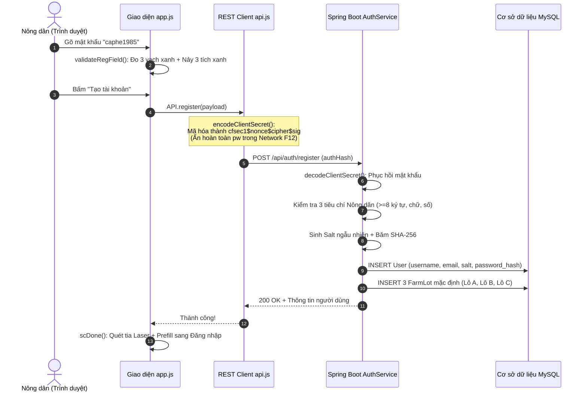

# 🎓 CẨM NANG THUYẾT TRÌNH CODE - CAFELEAF AI
> **Dành cho:** Báo cáo đồ án / Thuyết trình hội đồng chuyên môn  
> **Chủ đề:** Hệ thống Đăng ký, Đăng nhập, Bảo mật mật khẩu nhiều lớp & Thanh đo độ mạnh mật khẩu tối ưu cho Nông dân.

---

## 🗺️ 1. SƠ ĐỒ LUỒNG DỮ LIỆU TỔNG QUAN (END-TO-END FLOW)

---

## 📂 2. BẢNG TRA CỨU NHANH TỪNG FILE & ĐOẠN CODE

### File 1: `api.js` (Tầng REST API Client - Phía Trình Duyệt)
| Tên hàm / Đoạn code | Vị trí | Chức năng & Ý nghĩa thuyết trình |
| :--- | :--- | :--- |
| `encodeClientSecret(rawPw)` | Dòng 21–40 | **Bảo mật Network Payload:** Biến mật khẩu thô thành chuỗi `cfsec1$...` bằng nonce ngẫu nhiên và khóa động. Khi mở F12 DevTools -> Network -> Payload sẽ không bị lộ mật khẩu. |
| `request(url, options)` | Dòng 50–88 | **Quản lý gọi HTTP tập trung:** Bắt lỗi mất kết nối hoặc khi trình duyệt bật chế độ `Offline`, ném thông báo tiếng Việt rõ ràng cho người dùng. |
| `checkAuthAvailability(un, email)` | Dòng 99–104 | **Kiểm tra trùng lặp thời gian thực:** Gọi API ngầm `GET /api/auth/check` để báo đỏ ngay nếu tên đăng nhập hoặc email đã có người dùng. |
| `register(payload)` | Dòng 118–131 | **Đóng gói dữ liệu an toàn:** Tự động loại bỏ `pw2`, mã hóa `pw` thành `authHash` trước khi truyền lên Spring Boot. |

---

### File 2: `app.js` (Tầng Giao Diện Người Dùng & Hoạt Ảnh)
| Tên hàm / Đoạn code | Vị trí | Chức năng & Ý nghĩa thuyết trình |
| :--- | :--- | :--- |
| `pLogin()` | Dòng 1138–1196 | **Giao diện 2 thẻ đối xứng:** Màn hình đăng nhập & đăng ký chuyển đổi bằng tia laser. Chứa khung đo mật khẩu 3 vạch và 3 ô tích xanh. |
| `setFieldErr(inputId, msg)` | Dòng 1203–1213 | **Báo lỗi viền đỏ trực tiếp:** Thêm viền đỏ (`err-inp`) vào ô nhập liệu và hiển thị dòng cảnh báo `⚠️` ngay dưới chân ô. |
| `validateRegField(id, val)` | Dòng 1240–1371 | **Bộ não kiểm soát dữ liệu:** Kiểm tra Regex cho Tên đăng nhập, Email, Số điện thoại (chặn tuyệt đối chữ cái, chỉ nhận 10 số). |
| `validateRegField('r-pw')` | Dòng 1299–1340 | **Đo độ mạnh mật khẩu:** Kiểm tra 3 điều kiện (độ dài >= 8, có chữ, có số). Tự động đổi màu vạch (*Xám -> Đỏ -> Cam -> Xanh ngọc*) và nảy tích xanh. |
| `scTo(toReg)` & `scDone(un)` | Dòng 1378–1448 | **Hiệu ứng tia Laser & Hoàn tất:** Quét tia laser mượt mà, sau khi tạo tài khoản xong tự động điền sẵn tên đăng nhập và chuyển sang form đăng nhập. |
| `doReg(v)` & `doLogin(v)` | Dòng 1454–1512 | **Xử lý Submit biểu mẫu:** Kiểm tra hợp lệ trước khi gửi (Client-side pre-check) để không gửi request rác lên server. |

---

### File 3: `AuthService.java` (Tầng Dịch Vụ Nghiệp Vụ - Spring Boot Backend)
| Tên hàm / Đoạn code | Vị trí | Chức năng & Ý nghĩa thuyết trình |
| :--- | :--- | :--- |
| `decodeClientSecret(token)` | Dòng 45–78 | **Giải mã và kiểm tra tính toàn vẹn:** Phục hồi mật khẩu từ gói tin `cfsec1$...` và kiểm tra checksum, bảo vệ chống giả mạo request. |
| `register(dto)` | Dòng 80–140 | **Quy trình Đăng ký nghiệp vụ:** Bắt lỗi trùng lặp CSDL, áp dụng chuẩn mật khẩu 3 tiêu chí, băm mật khẩu với Salt ngẫu nhiên và khởi tạo 3 Lô vườn mặc định. |
| `login(dto)` | Dòng 142–185 | **Quy trình Đăng nhập nghiệp vụ:** Tìm kiếm người dùng bằng cả Email hoặc Tên đăng nhập, so sánh mật khẩu an toàn chống tấn công Timing Attack. |

---

### File 4: `api_server.py` & `YoloAiService.java` (Kiến Trúc FastAPI AI Microservice - Tuần 9 Backend)
| Tên Endpoint / Hàm | Vị trí | Chức năng & Ý nghĩa thuyết trình |
| :--- | :--- | :--- |
| `POST /predict` | `api_server.py` | **Nhận diện bệnh & khoanh vùng Bounding Box:** Cho phép chọn model (mặc định: `best.pt`), ngưỡng `conf`, chạy suy luận trong RAM không lưu file tạm ra đĩa, lưu vào CSDL SQLite và trả về danh sách vết bệnh + ảnh Base64. |
| `POST /compare` | `api_server.py` | **So sánh trực tiếp 2 mô hình:** Chạy 1 ảnh qua cả 2 model (ví dụ `best.pt` vs `yolo11n.pt`), so sánh độ trễ (latency ms) và số vết bệnh phát hiện được. |
| `GET /benchmark` | `api_server.py` | **Đo đạc hiệu năng & FPS:** Chạy kiểm thử tốc độ suy luận, trả về Latency trung bình (ms), FPS, cấu hình phần cứng CPU/GPU và kích thước file model. |
| `GET /history` & `/stats` | `api_server.py` | **Lịch sử & Thống kê CSDL:** Truy vấn dữ liệu nhận diện lưu trong SQLite, tính tỷ lệ % phân bố 5 lớp bệnh và độ tin cậy trung bình. |
| `GET /diseases` & `/models` | `api_server.py` | **Mô tả lớp bệnh & Danh sách Model:** Cung cấp thông tin triệu chứng, nguyên nhân, phác đồ điều trị của 5 lớp bệnh và danh sách các file `.pt` nạp trong RAM. |
| `runFastApiPredict()` | `YoloAiService.java` | **Cơ chế 3 tầng dự phòng (3-Tier Auto-Fallback):** Ưu tiên gọi FastAPI cổng 8000 (siêu tốc ~150ms). Nếu cổng 8000 tắt, tự động lùi về Python CLI `yolo_infer.py` (Tầng 2) hoặc Java Vision (Tầng 3), đảm bảo Web không bao giờ bị lỗi. |

---

## 🎯 3. BA LUẬN ĐIỂM "ĂN ĐIỂM" TRƯỚC HỘI ĐỒNG
1. **Thiết kế lấy Nông dân làm trung tâm (Farmer-Centric UX):** Thay vì các quy tắc mật khẩu đánh đố người dùng (ký tự đặc biệt, hoa thường phức tạp), hệ thống chỉ yêu cầu $\ge 8$ ký tự, có chữ và có số (ví dụ `caphe1985`, `vuonnha2026`).
2. **Bảo mật nhiều lớp (Defense in Depth):** Mật khẩu vừa được mã hóa trước khi gửi đi trên đường truyền, vừa được băm một chiều với Salt ngẫu nhiên trong MySQL (chuẩn NIST).
3. **Phản hồi thời gian thực mượt mà (Instant Feedback):** Kiểm tra lỗi ngay khi người dùng gõ phím, tự động chặn nhập chữ vào ô số điện thoại, và cập nhật thanh đo mật khẩu bằng các hiệu ứng chuyển động trực quan.
